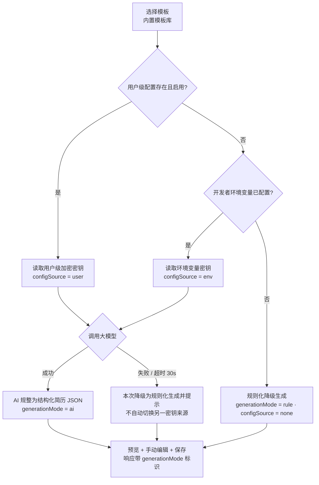
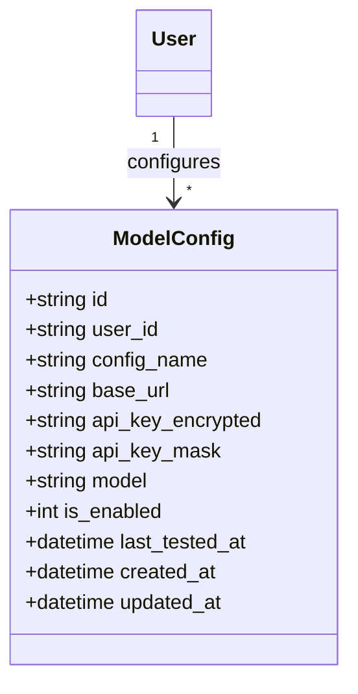

# 简历生成 Agent（resume_agent）增量 PRD — CR-001 大模型密钥自主配置

> 文档版本：v1.1（增量）｜ 文档类型：增量 PRD（**仅描述本次变更，不重写整份 PRD**）｜ 撰写：产品经理 许清楚
> 基线文档：`docs/01-PRD.md` v1.0（保持原样，不覆盖）
> 变更编号：**CR-001** ｜ 影响版本：**本期 MVP 内消化**（不新增版本、不延期）

---

## 1. 变更背景与范围

### 1.1 用户原话（逐字）

> 「大模型密钥后续开发者或用户可自主添加」

### 1.2 变更登记

| 项 | 内容 |
| --- | --- |
| 变更编号 | CR-001 |
| 提出时机 | v1.0 PRD 完成之后追加 |
| 影响版本 | 本期 MVP 内消化；MVP 交付判据同步补充（见第 6 节） |
| 关联基线条目 | 1.2 假设第 5 条、Q3、R-010、R-011、3.2 主链路、3.4 数据实体、3.5 安全与隐私、3.7 版本规划 |
| 变更性质 | 能力增强 + 既有条目修订；不新增端侧、不改动核心闭环形态 |

### 1.3 变更解读

- 密钥来源由基线中的「开发者环境变量」单一来源，扩展为**双来源**：① 开发者/部署者在环境变量中配置；② 终端用户在「设置 → 模型配置」页填入**自己的**密钥。
- 两者皆未配置时，**仍必须走规则化降级生成**，闭环不可中断（基线 R-011 硬性要求不变且被强化）。
- **真实密钥值一律不内置**：不硬编码、不写入代码仓库、不写入 PRD/示例文档（示例只用占位符 `<your-api-key>`），仅由开发者或用户在运行期自行填入。
- 统一走 **OpenAI 兼容协议**（`base_url` + `api_key` + `model`），不绑定任何特定厂商。
- 不变项：核心闭环、端侧范围、APP 安装包/应用商店上架/微信审核发布的 P2 边界、分享快照与隐私基线，全部维持 v1.0 定义。

### 1.4 配置优先级（建议默认值，待确认）

| 优先级 | 来源 | `configSource` | 说明 |
| --- | --- | --- | --- |
| 1（最高） | 用户级配置（设置页已保存且启用） | `user` | 用户自己的密钥与额度，覆盖部署级配置 |
| 2 | 开发者环境变量（`.env`：`LLM_BASE_URL` / `LLM_API_KEY` / `LLM_MODEL`，可加 `LLM_TIMEOUT`） | `env` | 部署者统一配置，对所有未自建配置的用户生效 |
| 3 | 均无 | `none` | 触发规则化降级生成，`generationMode=rule` |

> 补充规则（建议默认值，待确认）：选定来源后若调用失败/超时 30s，**本次请求直接降级为规则化生成并明确提示**，不自动切换到另一密钥来源（避免账单归属混淆）；用户可删除自己的配置以回落到环境变量链路。

---

## 2. 新增 / 修订需求条目

> 沿用 v1.0 需求池格式：`编号 | 描述 | 端侧 | 优先级 | 验收标准`。端侧说明同 v1.0；「设置页」指 PC 网页与移动 H5 的「设置 → 模型配置」。
> 优先级判断：**R-031~R-035 定 P0**——「开发者或用户可自主添加密钥」这一能力本身本期必须可跑通（能力必须交付，但**真实密钥值不内置**）；R-036 定 P1，R-037 定 P2（仅登记边界，本期不实现）。

| 编号 | 描述 | 端侧 | 优先级 | 验收标准 |
| --- | --- | --- | --- | --- |
| R-010（修订） | AI 生成简历：先按第 1.4 节优先级解析密钥来源，再汇总资料文本调用大模型，输出结构化 JSON；**响应必须携带 `generationMode` 与 `configSource` 标识** | PC、移动H5 + 服务端 | P0 | 有可用配置时返回合法结构化 JSON，字段填充率 ≥90%（资料可抽取信息范围内）；响应体含 `generationMode:"ai"` 与 `configSource:"user"`/`"env"`；生成过程有进度态，超时 30s 有明确提示并降级 |
| R-011（修订） | 生成降级触发条件明确为：**用户级配置与环境变量均为空，或选定来源调用失败/超时/异常**时，自动切换规则化生成（关键词抽取 + 模板字段填充） | 服务端 | P0 | 完全未配置任何密钥时完整闭环 100% 跑通并产出可读简历；响应 `generationMode:"rule"`、`configSource:"none"`；界面明确标注「当前为规则化生成」；失败降级场景界面有黄色提示条 |
| R-031（新增） | 开发者环境变量配置：服务端启动时读取 `LLM_BASE_URL` / `LLM_API_KEY` / `LLM_MODEL`（及可选 `LLM_TIMEOUT`），提供 `.env.example` 占位示例；无需改代码即可启用/停用 AI 生成 | 服务端 | P0 | 填入合法配置后重启服务，AI 生成可用且 `configSource:"env"`；删除配置后重启，自动生成走 `generationMode:"rule"`；`.env.example` 中只出现占位符、无任何真实密钥；缺少 `LLM_BASE_URL` 或 `LLM_MODEL` 时使用默认值并给出启动日志提示（日志不含密钥） |
| R-032（新增） | 用户级模型配置与测试连接：用户可在设置页新增/编辑自己的 OpenAI 兼容配置（配置名称、`base_url`、`api_key`、`model`、启用开关），并提供「测试连接」按钮 | PC、移动H5 + 服务端 | P0 | 保存后该用户生成走 `configSource:"user"`；「测试连接」在 10s 内返回成功/失败明确结果与耗时；无效密钥/错误 base_url 返回可读错误原因（不回显密钥明文）；测试请求不消耗简历生成额度、不产生简历记录 |
| R-033（新增） | 配置优先级与无密钥降级：实现第 1.4 节优先级解析；用户配置存在时覆盖环境变量；用户删除配置后回落环境变量；两者皆无走规则化生成 | 服务端 | P0 | 三级场景逐一可验证：仅环境变量→`env`；用户+环境变量并存→`user`；两者皆空→`rule`；删除用户配置后自动回落 `env`；调用失败时本次降级 `rule` 且不自动切换来源 |
| R-034（新增） | 密钥安全：**加密存储**（服务端 AES-256-GCM，加密密钥取自服务端环境变量、不入库）、**掩码回显**（如 `sk-****************3f9a`，仅末 4 位）、**不落日志**（请求/响应/异常/启动日志均无明文）、**公开接口不返回**（含分享查看页、二维码接口、任何未鉴权响应） | 服务端 + 全端 | P0 | 数据库与备份文件中不出现密钥明文；任意接口响应体（含错误体）不含完整密钥（掩码也不出现在公开接口）；全链路日志检索 `sk-` 等密钥前缀无命中；A 用户无法通过接口读取/使用 B 用户配置（返回 403）；删除配置后密文不可恢复 |
| R-035（新增） | 生成模式可观测：生成接口与简历记录保存 `generationMode`（`ai`/`rule`）、`configSource`（`user`/`env`/`none`）；编辑/预览页展示当前生成来源标识 | PC、移动H5 + 服务端 | P0 | 每次生成结果可回溯来源；P4 页面在 AI 生成时显示「AI 生成 · 来源是「我的配置」/「部署配置」」，规则化生成时显示「当前为规则化生成」；标识与响应字段一致，无「显示 AI 实为规则化」的错标 |
| R-036（新增） | 多套用户配置管理：支持保存多套配置、启停切换、删除（二次确认）、展示创建时间与最后测试时间 | PC、移动H5 + 服务端 | P1 | 可并存 ≥2 套配置且仅 1 套为启用态；删除需二次确认；切换后新生成请求立即采用新配置 |
| R-037（新增，边界登记） | 密钥计费/配额管理、用量账单、多租户密钥池、密钥团队共享 | 全端 + 服务端 | P2 | **本期不实现，不纳入编码范围**，仅登记为后续评估项 |

---

## 3. 新增用户故事（3 条）

1. 作为**开发者/部署者**，我希望通过环境变量配置大模型密钥与接口地址，以便部署后无需改动代码即可启用 AI 生成，且真实密钥不进入代码仓库。
2. 作为**用户**，我希望在「设置 → 模型配置」里填入自己的 OpenAI 兼容密钥并先测试连接，以便用我自己的额度生成简历，不必依赖部署方是否配置密钥。
3. 作为**未配置任何密钥的用户**，我希望仍能一键生成简历并看到「当前为规则化生成」的明确提示，以便试用与演示不被密钥缺失阻塞，且清楚知道结果不是 AI 生成的。

---

## 4. 新增页面 P8「设置 → 模型配置」

> 全局约定沿用 v1.0：顶部导航「用户头像下拉 → 设置」进入；危险操作二次确认；加载/空态/错误/成功四类状态全站统一；PC 与移动 H5 均需覆盖。

| 项 | 内容 |
| --- | --- |
| 布局 | PC：左侧设置二级导航（模型配置 / 账号安全），右侧主区表单卡片（max-width 720px）；移动 H5：单列上下堆叠，底部固定「保存」按钮。顶部为「当前生效来源」状态条（用户配置 / 部署配置 / 未配置-规则化生成） |
| 主要组件 | 配置名称输入框；`base_url` 输入框（默认 `https://api.openai.com/v1` 占位提示）；`api_key` 输入框（**`type="password"`**，右侧显隐切换图标，已保存后以掩码回显）；`model` 输入框/下拉（默认占位 `gpt-4o-mini` 类通用值）；「启用此配置」开关；「测试连接」次级按钮；「保存」主按钮；「删除配置」危险按钮；风险提示文案；状态标签；加载骨架屏；错误提示条 |
| 风险提示（必展示） | 「密钥仅用于你本人的简历生成，服务端加密存储；请勿使用共享/公用密钥。未配置或调用失败时，系统将自动使用规则化生成，简历仍可正常生成。」 |
| 交互状态 | ① **未配置**：空态插画 +「添加模型配置」按钮，顶部状态条显示「未配置 · 当前为规则化生成」；② **已配置**：字段回填、`api_key` 仅显示掩码、状态条显示「已生效 · 来源是「我的配置」」、显示最后测试时间；③ **测试连接中**：按钮 loading + 禁用重复点击，10s 超时自动结束；④ **测试成功**：绿色 toast「连接成功（耗时 X.Xs）」+ 状态标签更新；⑤ **测试失败**：红色错误条展示可读原因（如「密钥无效 / 接口地址不可达 / 超时」），**不回显密钥明文**，配置保留可编辑；⑥ **保存成功/失败**：成功 toast + 状态条刷新，失败字段级红字提示；⑦ **删除二次确认**：弹窗明确「删除后该密钥不可恢复，未配置其他密钥时将回退到规则化生成」，确认后密文清除、状态条刷新；⑧ **掩码展示**：任何列表/回显/日志/接口响应均不出现完整密钥；⑨ 表单校验：`base_url` 必须为合法 HTTPS URL、`api_key`/`model` 非空，未通过时「保存」禁用 |

**配置字段清单**

| 字段 | 类型 | 必填 | 说明 |
| --- | --- | --- | --- |
| `config_name` | string | 是 | 用户自定义名称，仅本人可见 |
| `base_url` | string | 是 | OpenAI 兼容接口地址，默认占位，可填任意兼容服务 |
| `api_key` | string（加密） | 是 | `type="password"` 录入，服务端 AES-256-GCM 加密存储，仅掩码回显 |
| `model` | string | 是 | 模型名，允许自由填写 |
| `is_enabled` | boolean | 是 | 启用开关；同一用户最多 1 套启用（P1 多套时） |
| `last_tested_at` | datetime | 否 | 最近一次测试连接时间（不记录测试结果中的密钥） |

---

## 5. 对原 PRD（v1.0）的修订点清单

| 编号 | 原 PRD 位置 | 原内容摘要 | 修订后内容 | 影响 |
| --- | --- | --- | --- | --- |
| M-01 | 3.6 待确认问题 **Q3**（大模型供应商、密钥来源与费用） | 「通过环境变量配置 OpenAI 兼容接口；未配置时强制走规则化降级生成；不绑定特定厂商」 | **Q3 答案更新并转为「已确认」**：密钥来源为「开发者环境变量 + 用户设置页自主配置」双通道，优先级见本增量第 1.4 节；仍统一 OpenAI 兼容协议、不绑定厂商；Q3 不再作为阻塞开发的待确认项 | 待确认清单减少 1 项；开发按确认值执行 |
| M-02 | 1.2 项目背景与默认假设 **第 5 条**（AI 生成） | 「调用大模型规整资料；若模型密钥缺失，必须可降级为规则化生成」 | **补充**：① 密钥由开发者（环境变量）或用户（设置页）在运行期自主添加，真实值不内置；② 降级触发条件为「两级配置均为空或选定来源调用失败/超时」；③ 生成结果需带 `generationMode`/`configSource` 标识 | 假设条目标注仍为「假设，待确认」，但补充内容按 CR-001 执行 |
| M-03 | 3.1 需求池 **R-010** | 「汇总资料文本调用大模型，输出结构化 JSON」 | **补充**：调用前先解析密钥来源优先级；响应体新增 `generationMode`、`configSource`；验收标准新增标识一致性校验 | 需求池条目修订（不新增编号） |
| M-04 | 3.1 需求池 **R-011** | 「模型密钥缺失/接口异常时自动切换规则化生成」 | **补充并明确**：「密钥缺失」定义为两级配置均为空；增加「选定来源调用失败/超时不自动切换来源，本次直接降级」；界面必须标注「当前为规则化生成」 | 需求池条目修订（不新增编号） |
| M-05 | 3.2 关键流程 **主链路 flowchart** | `G["选择模板"] --> H{"调用大模型生成"}` 直接进入生成判断 | **在 G 与 H 之间插入「配置解析优先级」分支**（见下方增量流程图片段）；H 节点语义改为「解析密钥来源 → 调用大模型」；新增「调用失败/超时 → 本次降级规则化生成」分支；`K` 节点补充「响应带 generationMode 标识」 | 流程图需按片段替换局部，其余节点保持不变 |
| M-06 | 3.5 非功能需求 **安全** 与 **隐私合规** | 安全含密码/会话/越权/分享 token/上传/HTTPS；隐私含默认私有、最小必要、快照等 | **安全条款补充**：密钥 AES-256-GCM 加密存储（加密密钥取自服务端环境变量、不入库）、掩码回显（仅末 4 位）、明文密钥不落任何日志/错误体、公开接口（含分享查看页与二维码接口）不返回任何密钥字段、用户级配置跨用户隔离（403）、删除后不可恢复。**隐私条款补充**：用户密钥属敏感个人信息，仅本人可见可用、不用于训练、不向第三方共享、开启分享前提示密钥与简历内容无关且不外泄 | 安全与隐私验收用例需同步扩充 |
| M-07 | 3.3 UI 设计稿 | 7 个核心页面 P1~P7 | **新增 P8「设置 → 模型配置」**（本增量第 4 节）；**P4 简历编辑/预览页**顶部提示条补充「AI 生成 · 来源：我的配置/部署配置」与「当前为规则化生成」两种标识（R-035） | 核心页面增至 8 个 |
| M-08 | 3.4 数据实体草图 | User / Resume / Material / Template / ShareLink 五个实体 | **建议新增 `ModelConfig` 实体**（字段与关系见下方 classDiagram 片段），`User "1" --> "*" ModelConfig : configures`；`Resume` 可选增加 `generation_mode` / `config_source` 字段用于回溯 | 数据模型新增 1 个实体、2 个可选字段 |
| M-09 | 3.7 版本规划 **MVP 行** | MVP 范围含「AI 生成 + 无密钥规则化降级」 | **MVP 范围新增**：「密钥自主配置（开发者环境变量 + 用户设置页 P8）+ 测试连接 + 配置优先级解析 + `generationMode`/`configSource` 标识 + 密钥加密与掩码」；**交付判据新增**：AC-01 与 AC-02（见第 6 节）。V1.1 增加 R-036 多套配置管理；R-037 计费/配额管理列 P2 | MVP 编码范围扩大但不改交付节奏，APP 打包/小程序审核仍在 P2 不纳入本期 |
| M-10 | 4. 交付边界提醒 | 4 条边界提醒 | **新增 1 条**：「本期不内置任何真实密钥值；密钥仅由开发者或用户在运行期自行填入，代码仓库、文档与示例配置中只允许出现占位符」 | 给架构师的提醒同步补充 |

### M-05 主链路「配置解析优先级」分支片段（替换 3.2 中 G→H 局部）

> 说明：原 3.2 流程图中 `H{"调用大模型生成"}` 及其两条出边（`密钥可用` / `密钥缺失 / 超时 / 异常`）由上述片段整体替换；`I`/`J`/`K` 及后续节点语义保持不变，`K` 补充标识文案。

### M-08 新增数据实体片段

| 字段 | 说明 |
| --- | --- |
| `api_key_encrypted` | AES-256-GCM 密文（含随机 IV），加密密钥取自服务端环境变量，**不入库** |
| `api_key_mask` | 掩码串（如 `sk-****************3f9a`），仅供本人设置页回显，公开接口一律不返回 |
| `is_enabled` | 启用态；MVP 每用户最多 1 套启用配置 |
| `user_id` | 强制归属过滤字段，所有查询按当前登录用户隔离 |

---

## 6. 验收标准（CR-001 增量）

| 编号 | 验收项 | 判据 |
| --- | --- | --- |
| **AC-01（必须）** | 无密钥闭环 | **完全未配置任何密钥**（环境变量为空、用户未添加任何配置）时，「注册 → 上传 → 选模板 → 生成 → 分享 → 扫码查看」闭环仍 **100% 跑通**；生成结果可读；界面明确标注「当前为规则化生成」；响应 `generationMode="rule"`、`configSource="none"` |
| **AC-02（必须）** | 配置后 AI 生成与标识 | 任一来源配置有效后走 AI 生成，且**响应必须带 `generationMode` 标识**（`generationMode="ai"` 且 `configSource="user"` 或 `"env"`）；界面显示对应来源标识，标识与响应一致、无错标 |
| AC-03 | 优先级与回落 | 用户配置 + 环境变量并存时采用用户配置（`user`）；删除用户配置后回落 `env`；两者皆空回落 `rule`；选定来源调用失败/超时，本次直接降级 `rule` 且不自动切换来源 |
| AC-04 | 测试连接 | 「测试连接」10s 内返回成功/失败与耗时；失败给出可读原因且不回显密钥明文；测试不产生简历记录 |
| AC-05 | 密钥安全 | 数据库/备份/日志/错误体/接口响应均无密钥明文；设置页仅掩码回显；`api_key` 输入框 `type="password"`；删除后密文不可恢复 |
| AC-06 | 公开接口隔离 | 扫码公开查看页、二维码生成接口及所有未鉴权响应中不含任何密钥字段（含掩码与配置名称）；A 用户读取/使用 B 用户配置返回 403 |
| AC-07 | 不内置真实密钥 | 代码仓库、`.env.example`、PRD/文档、示例数据中只出现占位符（如 `<your-api-key>`），检索无真实密钥格式命中 |
| AC-08 | 厂商无关 | 更换任意 OpenAI 兼容 `base_url` + `model` 组合后，无需改代码即可正常生成；不出现厂商专有字段或适配分支 |

---

## 7. 边界（本期不做）

1. **本期不内置任何真实密钥值**：不硬编码、不随代码/文档/镜像分发，真实密钥仅由开发者（环境变量）或用户（设置页）在运行期自行填入；示例一律使用占位符。
2. **不绑定特定厂商**：统一 OpenAI 兼容协议（`base_url` + `api_key` + `model`），不做厂商专有 SDK 适配层、不预设白名单厂商。
3. **不做密钥计费 / 配额管理 / 用量账单**（R-037，列 P2 后续评估）；不做多租户密钥池、不做团队/组织级密钥共享，用户级密钥仅本人可用。
4. **不改动既有边界**：核心闭环形态、端侧范围、分享快照 + 可撤销的隐私基线不变；APP 原生安装包打包、应用商店上架、微信小程序审核发布仍在 P2/后续阶段，**不因本次变更拉回本期编码范围**。
5. **不引入新的外部强依赖**：未配置密钥时系统不得因缺少第三方服务而无法启动或无法演示。

---

## 8. 给架构师的增量提醒

- 密钥解析应是**服务端单一入口**（如 `resolveModelConfig(userId)`），业务生成逻辑只消费解析结果，不在前端传递或拼接密钥。
- 「用户级配置」与「部署级环境变量」是两条独立来源，禁止在调用失败时静默互换，避免费用归属不清。
- `generationMode` / `configSource` 是本次可观测性的硬要求，需在生成接口响应与简历记录中同时留痕（留痕不含密钥）。
- 公开查看页（P7）与二维码接口属于未鉴权路径，任何配置字段都不得随快照或响应带出。
