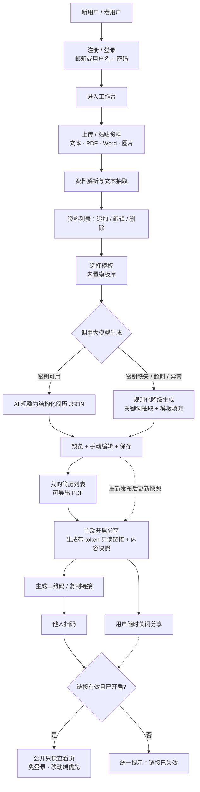
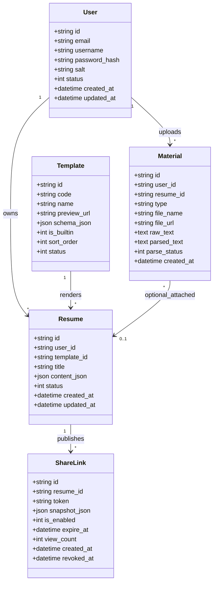

# 简历生成 Agent（resume_agent）产品需求文档 PRD

> 文档版本：v1.0 ｜ 文档类型：简单 PRD ｜ 撰写：产品经理 许清楚
> 说明：本次用户未要求竞品/市场分析，故本文档不含竞品分析与 Mermaid 象限图。

---

## 1. 项目信息

| 项 | 内容 |
| --- | --- |
| Language | 简体中文（界面文案、简历模板、文档全部简体中文） |
| Programming Language / 技术栈 | 默认 PC 网页：Vite + React + MUI + Tailwind CSS；服务端：Node.js + SQLite（假设，待确认）；跨端：Taro（React 语法）/ 响应式 H5 + PWA 壳编译微信小程序与移动 APP（假设，待确认） |
| Project Name | `resume_agent` |
| 工作目录 | `D:/workbuddy_project/resume-agent/`（假设，待确认） |
| 产出文件 | `D:/workbuddy_project/resume-agent/docs/01-PRD.md` |

### 1.1 原始需求复述（逐字）

> 「做一个能够根据用户上传的资料履历自动生成简历的agent，要求用户可以自己选择模板，后续可以直接添加资料，电脑端做成网页，手机做成APP和微信小程序，他人可以识别二维码查看用户简历，用户需密码登录注册使用」

### 1.2 项目背景与默认假设（以下每条均为「假设，待确认」）

1. **【假设，待确认】项目工作目录**：`D:/workbuddy_project/resume-agent/`，PRD 保存为 `docs/01-PRD.md`。
2. **【假设，待确认】交付优先级**：本期先交付「可运行的核心闭环 MVP」：注册/登录 → 上传/追加资料 → 选模板 → AI 生成简历 → 二维码分享查看。APP 原生安装包打包、应用商店上架、微信审核发布属于后续发布阶段事项，写入 P2/后续阶段，**不纳入本期编码范围**。
3. **【假设，待确认】端侧范围**：PC 网页（完整闭环）、移动 APP（跨端方案或响应式 H5/PWA 壳）、微信小程序（同套跨端代码编译）、分享查看页（H5，公开可访问，扫码即看，只读）。
4. **【假设，待确认】账号体系**：用户名/邮箱 + 密码注册登录，密码加盐哈希存储（bcrypt/argon2），登录态使用会话 token（JWT），支持登出与 token 过期。
5. **【假设，待确认】AI 生成**：调用大模型把用户零散资料（文本、PDF/Word/图片 OCR 结果等）规整为结构化简历；**若模型密钥缺失，必须可降级为规则化生成（模板字段填充）**，保证 demo 100% 可跑通。
6. **【假设，待确认】隐私基线**：简历默认私有，分享需用户主动开启并生成带 token 的二维码链接，可随时关闭，关闭后链接立即失效。
7. **【假设，待确认】跨端技术选型**：PC 用 Vite + React；移动端与小程序用 Taro（React）复用组件/类型/请求层，MVP 阶段先以响应式 H5 覆盖手机浏览器，PWA 壳与小程序编译列入 P1/P2。
8. **【假设，待确认】存储与部署**：MVP 单机可运行，SQLite + 本地文件存储（上传资料、二维码图片），不依赖外部付费服务即可启动；后续可平滑替换为云端数据库与对象存储。
9. **【假设，待确认】资料解析范围**：MVP 支持文本粘贴、TXT/MD 直接入库、PDF/DOCX 文本抽取、图片文件仅上传存储；图片 OCR 文字识别列入 P1（可接第三方 OCR，缺失时降级为「仅存档、不参与生成」）。
10. **【假设，待确认】分享内容形态**：分享采用「发布快照」，即开启分享时对简历内容生成只读快照；用户后续编辑简历不会自动改变已分享内容，需用户重新发布才更新（避免误泄露未定稿内容）。
11. **【假设，待确认】模板供给**：MVP 内置 ≥3 套简历模板（简约/专业/创意），模板以结构化 schema + 样式配置描述，支持后续扩充，不做用户自定义模板编辑器。

### 1.3 优先级定义

- **P0（Must have）**：本期 MVP 必须交付，缺失则核心闭环不成立。
- **P1（Should have）**：V1.1 交付，提升完整度与体验，不阻塞 MVP。
- **P2（Nice to have / 后续阶段）**：含平台发布与商业化增强，本期不编码。

---

## 2. 产品定义

### 2.1 产品目标

**一句话目标**：让用户把零散的履历资料一键变成规范、可切换模板、可扫码分享的私有简历。

**3 条可衡量目标**：

| 编号 | 目标 | 衡量指标 |
| --- | --- | --- |
| G1 | 核心闭环高效可用 | 新用户从注册到生成简历并拿到二维码 ≤ 5 分钟、操作步数 ≤ 6 步；闭环全流程通过率 100%（含无密钥降级链路） |
| G2 | 生成结果可用、可控 | 基于资料中可抽取信息，结构化简历字段填充率 ≥ 90%；生成后 100% 支持人工预览编辑与保存；模型密钥缺失时规则化降级生成成功率 100% |
| G3 | 多端一致与隐私安全 | PC 网页覆盖 100% 闭环功能，移动 H5 覆盖扫码查看 + 资料追加 + 简历查看；未开启分享的简历被未登录/越权访问的成功率 = 0（越权测试用例通过率 100%）；主流手机与微信扫一扫打开公开查看页成功率 ≥ 95% |

### 2.2 目标用户与核心场景

| 角色 | 特征 | 核心场景 |
| --- | --- | --- |
| ① 求职者（主用户，应届生/跳槽者/自由职业者） | 履历资料零散：项目记录、实习证明、证书、成绩单、PDF/Word 旧简历；不会排版、措辞耗时 | 一次性批量上传资料 → 选模板 → AI 生成 → 微调 → 生成二维码，用于投递、面试现场、社交分享；后续拿到新证书随时追加资料并重新生成 |
| ② 招聘方/合作方（访客，未注册） | 手机扫码进入，耐心短，只读浏览 | 扫描候选人提供的二维码，免登录、无需安装 APP 直接查看只读简历，快速判断匹配度 |
| ③ 多端续作者（主用户的延伸场景） | PC 上深度整理，通勤/现场用手机 | PC 端完成资料整理与生成，手机浏览器/微信小程序上追加资料、切换模板、开关分享、查看他人扫码效果 |

### 2.3 用户故事（12 条）

1. 作为**新用户**，我希望用邮箱（或用户名）+ 密码注册并登录，以便我的简历与资料被私有保存、换设备后可继续。
2. 作为**求职者**，我希望批量上传 PDF/Word/文本履历资料并自动提取文字，以便不必手工重录全部内容。
3. 作为**求职者**，我希望对已上传资料随时追加、编辑、删除，以便把新项目、新证书补进去而无需重建简历。
4. 作为**求职者**，我希望从模板库挑选模板并随时切换，以便针对不同岗位呈现不同风格且内容不丢失。
5. 作为**求职者**，我希望一键让 AI 把零散资料规整为结构化简历，以便节省排版与措辞时间。
6. 作为**求职者**，我希望生成后能预览并手动修改任意字段，以便修正 AI 的遗漏、错误或措辞。
7. 作为**求职者**，我希望保存多个简历版本并导出 PDF，以便面向不同公司投递。
8. 作为**求职者**，我希望主动开启分享并生成带 token 的二维码/链接，以便把简历给别人而无需暴露账号密码。
9. 作为**求职者**，我希望随时关闭分享，以便撤回已发出的简历、立即让旧二维码失效。
10. 作为**招聘方（访客）**，我希望扫码后免登录直接查看只读简历，以便快速了解候选人且无需注册。
11. 作为**多端续作者**，我希望在手机浏览器/微信小程序上继续追加资料、切换模板与管理分享，以便随时随地更新简历。
12. 作为**用户**，我希望未登录访问任何私有页面都被拦截到登录页、他人无法通过改 ID 访问我的资料，以便个人履历信息不泄露。

---

## 3. 技术规范

### 3.1 需求池

> 端侧说明：`PC`=PC 网页；`移动H5`=手机浏览器/PWA；`小程序`=微信小程序；`公开H5`=扫码只读页；`服务端`=后端接口与数据层；`全端`=上述全部。

| 编号 | 需求描述 | 端侧 | 优先级 | 验收标准 |
| --- | --- | --- | --- | --- |
| R-001 | 用户注册：邮箱/用户名 + 密码（含确认密码），校验格式与唯一性 | 全端 | P0 | 密码 ≥8 位且含字母+数字；重复邮箱/用户名返回明确错误；注册成功后密码以加盐哈希入库，数据库中不出现明文密码 |
| R-002 | 用户登录：支持邮箱或用户名 + 密码，返回会话 token | 全端 | P0 | 正确凭据 2s 内登录成功并返回 token；密码错误连续 5 次锁定 5 分钟并提示；token 默认有效期 7 天 |
| R-003 | 登出：清除会话 token 并跳转登录页 | 全端 | P0 | 登出后携带旧 token 访问任意私有接口返回 401 |
| R-004 | 登录态保持与鉴权拦截：刷新不掉线；未登录访问私有页跳登录 | 全端 + 服务端 | P0 | 刷新页面保持登录；直接输入私有页 URL 100% 跳登录并回跳原地址 |
| R-005 | 资料上传：支持文本粘贴、TXT/MD/PDF/DOCX 文件上传、图片文件上传（仅存档） | PC、移动H5 | P0 | 单文件 ≤10MB，单用户 ≤50 个资料；支持多选批量上传，逐条显示成功/失败原因 |
| R-006 | 资料解析：PDF/DOCX/TXT/MD 抽取为纯文本并入库 `parsed_text` | 服务端 | P0 | 常见中英文 PDF/DOCX 抽取成功率 ≥90%；解析失败时资料仍可保存并标记「解析失败，可手动补录」 |
| R-007 | 资料追加、编辑、删除与列表查看（含来源类型、时间、解析状态） | PC、移动H5 | P0 | 增删改后列表即时刷新；删除需二次确认；资料与简历解耦，删除资料不删除已生成简历内容 |
| R-008 | 模板库：内置 ≥3 套模板，展示缩略图、名称、适用场景，支持预览 | 全端 | P0 | 内置模板 ≥3 套且均可渲染示例数据；列表加载 ≤1s |
| R-009 | 模板切换：切换模板保留已编辑内容，仅换样式/版式 | 全端 | P0 | 切换后所有已填字段值不变，仅样式变化；刷新后保留最后一次选择 |
| R-010 | AI 生成简历：汇总资料文本调用大模型，输出结构化 JSON（基本信息/教育/工作/项目/技能/证书/自我评价） | PC、移动H5 + 服务端 | P0 | 有密钥时返回合法结构化 JSON，字段填充率 ≥90%（资料可抽取信息范围内）；生成过程有进度/加载态，超时 30s 有明确提示 |
| R-011 | 生成降级：模型密钥缺失/接口异常时自动切换规则化生成（按关键词抽取 + 模板字段填充） | 服务端 | P0 | 未配置任何密钥时，完整闭环仍可跑通并产出可读简历；降级在界面明确标注「当前为规则化生成」 |
| R-012 | 简历预览与手动编辑：所见即所得，支持段落增删改、字段排序、实时预览 | PC、移动H5 | P0 | 任一字段可编辑并即时反映到预览；编辑后必须手动/自动保存，刷新不丢内容 |
| R-013 | 简历保存与多版本：草稿/定稿状态，支持另存为新版本 | PC、移动H5 | P0 | 保存后生成简历记录；支持 ≥2 个版本并存互不覆盖 |
| R-014 | 我的简历列表：展示缩略信息、模板、更新时间、分享状态，支持新建/重命名/删除/设为当前 | 全端 | P0 | 列表按更新时间倒序；删除需二次确认；状态标识清晰（草稿/已定稿/分享中/已关闭） |
| R-015 | 分享开关：用户主动开启分享，生成带高熵 token 的公开只读链接 | PC、移动H5 + 服务端 | P0 | 默认「未分享」；开启后生成 token（≥128bit 随机）；链接无需登录即可访问；重复开启沿用/新生成 token 行为一致 |
| R-016 | 二维码生成与下载：基于分享链接生成二维码，支持复制链接、下载图片 | PC、移动H5 | P0 | 二维码 1s 内生成；微信扫一扫、系统相机均可识别并正确跳转；支持下载 PNG |
| R-017 | 关闭/撤销分享：一键关闭，链接与二维码立即失效 | PC、移动H5 + 服务端 | P0 | 关闭后 1s 内旧链接返回「链接已失效」且不泄露任何简历内容；重新开启可生成新链接 |
| R-018 | 扫码公开查看页：免登录、只读、移动端优先适配，无任何编辑入口 | 公开H5 | P0 | 未登录可访问；页面不出现编辑/删除/后台入口；不展示用户邮箱、手机号等账号信息；失效链接显示统一提示页 |
| R-019 | 权限与隐私：所有私有接口校验资源归属，简历默认私有 | 服务端 | P0 | 用 A 用户 token 访问 B 用户简历/资料/模板数据返回 403；未开启分享的简历通过任何公开路径均不可读；分享为内容快照，编辑不自动外泄 |
| R-020 | 多端适配：PC 完整闭环；移动 H5 响应式覆盖查看/追加/生成/分享；布局自适应 | PC、移动H5 | P0 | 375px~1920px 宽度无横向滚动、无组件重叠；移动端核心按钮可点区域 ≥44×44px |
| R-021 | 导出 PDF：将当前简历按所选模板导出 | PC、移动H5 | P1 | 导出文件中文不乱码、分页不截断文字；MVP 阶段可先用浏览器「打印/另存为 PDF」兜底并标注 |
| R-022 | 图片 OCR 识别：对上传图片提取文字并纳入生成资料 | 服务端 | P1 | 常见清晰证件/截图文字识别可用；无 OCR 能力时降级为「仅存档」且不阻塞生成 |
| R-023 | 生成增强：重新生成、按段落局部重写、生成历史版本对比 | PC | P1 | 重新生成不覆盖已有版本，用户可选择替换或另存 |
| R-024 | 分享增强：有效期（7/30 天/永久）、访问次数统计、访问来源趋势 | PC、服务端 | P1 | 过期链接自动失效；查看次数可查且与实际情况一致 |
| R-025 | 模板扩充与样式自定义：模板 ≥6 套，支持主色/字号切换 | 全端 | P1 | 新增模板无需改业务代码，仅通过配置/schema 接入 |
| R-026 | 微信小程序端：同套跨端代码编译，覆盖登录、资料追加、简历查看、分享开关 | 小程序 | P1 | 微信开发者工具与真机预览下主链路可用；分享查看走 web-view/H5 |
| R-027 | 移动 APP 壳：PWA/跨端壳打包，支持桌面图标启动与基础离线查看 | 移动APP | P1 | 安卓可安装运行；核心页面与 H5 表现一致 |
| R-028 | 找回密码 / 邮箱验证 / 第三方登录（微信一键登录） | 全端 | P2 | 后续阶段交付，MVP 不实现 |
| R-029 | APP 原生安装包打包（Android/iOS）、应用商店上架；微信小程序审核发布 | 移动APP、小程序 | P2 | **本期不编码**，仅作为发布阶段事项登记 |
| R-030 | 高级 AI 能力：按岗位 JD 优化措辞、多语言简历、简历评分；团队/企业多成员协作 | 全端 + 服务端 | P2 | 后续阶段评估 |

### 3.2 关键流程（主链路）

### 3.3 UI 设计稿（7 个核心页面）

> 全局：顶部导航栏（Logo「简历 Agent」+ 工作台/我的简历/资料库入口 + 用户头像下拉：设置/登出）；一级配色以中性蓝灰为主，主按钮统一为主色实心；所有危险操作（删除、关闭分享、登出）二次确认；加载、空态、错误、成功四类状态全站统一组件。

| # | 页面 | 布局 | 主要组件 | 交互状态 |
| --- | --- | --- | --- | --- |
| P1 | 登录 / 注册页 | 居中卡片（宽 400px，PC 左右分栏：左侧产品价值文案 + 插画，右侧表单）；移动端单列全宽卡片 | Tab 切换「登录/注册」；邮箱/用户名输入、密码输入（显隐切换）、确认密码（注册）、「记住我」、主按钮、错误提示条、跳转链接 | 空态：按钮禁用；校验中：字段级红字提示；提交中：按钮 loading 防重复；失败：顶部错误条（密码错误/账号已存在/锁定倒计时）；成功：跳工作台并 toast「欢迎回来」 |
| P2 | 资料管理页（工作台主区） | 左侧窄导航（资料库/模板/我的简历），右侧主区：顶部「上传资料」工具条 + 拖拽上传区，下方资料卡片/表格列表；移动端上下堆叠 | 拖拽/选择文件上传、批量多选、文本粘贴输入框、资料卡片（类型图标、名称、解析状态标签、时间、操作菜单：编辑/删除/重新解析）、解析进度条、空态插画 | 空态：「还没有资料，上传第一份吧」+ 引导按钮；上传中：逐文件进度与取消；解析中/失败/成功三种标签；删除：二次确认弹窗；编辑：抽屉式侧滑面板；超限：明确提示 10MB/50 份 |
| P3 | 模板选择页 | 顶部标题 + 适用场景筛选，下方 3 列模板卡片网格（移动端 1~2 列），卡片含缩略预览图 | 模板卡片（缩略图、名称、标签、适用岗位）、「预览大图」弹窗、「使用此模板」按钮、当前模板标识 | 悬停：卡片浮起 + 预览按钮；选中：主色描边 + 「当前使用」角标；切换：内容不丢失提示 toast；加载中：骨架屏；预览弹窗支持左右切换模板 |
| P4 | 简历编辑 / 预览页 | 左右双栏（PC 左 45% 编辑表单、右 55% 实时预览；移动端 Tab 切换「编辑/预览」）；顶部工具条：保存、另存版本、重新生成、导出 PDF、去分享 | 分区可折叠编辑表单（基本信息/教育/工作/项目/技能/证书/自评），字段增删与拖拽排序；右侧按模板渲染的 A4 比例预览；生成进度条；「规则化生成」标识 | 生成中：遮罩 + 进度文案 + 可取消；生成完成：字段高亮填充提示；编辑中：实时预览（防抖 300ms）；未保存：顶部「有未保存修改」提示；保存成功/失败 toast；降级生成：顶部黄色提示条 |
| P5 | 我的简历列表页 | 顶部「+ 新建简历」按钮 + 搜索/状态筛选，下方简历卡片网格（缩略图、标题、模板名、更新时间、状态标签） | 简历卡片、状态筛选（全部/草稿/已定稿/分享中/已关闭）、卡片操作菜单（编辑/重命名/复制/删除/分享）、空态引导 | 空态：引导「用资料生成第一份简历」；加载中：骨架屏；删除：二次确认；分享中：卡片显示二维码小图标；操作后列表即时刷新 |
| P6 | 分享与二维码页 | 居中双栏：左侧分享设置卡（开关、有效期、链接、状态），右侧二维码展示卡；移动端上下堆叠 | 分享开关（默认关闭）、只读链接输入框 + 复制按钮、二维码大图 + 「下载二维码」、有效期选择（P1）、访问次数（P1）、「关闭分享」危险按钮、风险提示文案「任何拿到链接的人都可查看」 | 关闭态：二维码区域显示锁形占位 + 说明；开启中：开关 loading；已开启：绿色「分享中」标签 + 二维码 1s 内呈现；关闭：二次确认后二维码置灰、链接标记失效；复制成功 toast；链接失效：明确提示 |
| P7 | 公开查看页（扫码进入） | 单列、移动端优先（max-width 720px），顶部仅展示简历标题与更新时间，主体为按模板渲染的只读简历；无导航栏、无登录入口 | 只读简历渲染区、底部「由 简历 Agent 生成」标识、失效提示页、加载骨架屏 | 有效：直接渲染快照内容，纯只读（无编辑/删除/跳转后台按钮）；加载中：骨架屏；链接失效/已关闭：统一「链接已失效或已被作者关闭」页，不泄露任何内容；不展示用户邮箱/手机号等账号信息；深浅色背景自适应 |

### 3.4 数据实体草图

| 实体 | 关键字段说明 | 关系与约束 |
| --- | --- | --- |
| User | `password_hash` + `salt` 加盐哈希；`email`/`username` 唯一索引；`status` 启用/锁定 | 1:N 拥有 Resume、Material；删除账号需级联清理资料、简历、分享链接 |
| Resume | `content_json` 存结构化简历内容（基本信息/教育/工作/项目/技能/证书/自评）；`status` 草稿/定稿 | 归属 User；N:1 引用 Template；1:N 生成 ShareLink；`user_id` 为所有查询的强制过滤条件 |
| Material | `type`：text/txt/md/pdf/docx/image/ocr_text；`file_url` 本地文件路径；`parse_status`：待解析/成功/失败/跳过 | 归属 User；`resume_id` 可空（资料库跨简历复用，删除资料不影响已生成简历内容） |
| Template | `schema_json` 定义字段与渲染配置；`is_builtin` 内置标识 | 1:N 被 Resume 引用；仅通过配置新增，不改业务代码 |
| ShareLink | `token` 唯一索引、≥128bit 随机；`snapshot_json` 发布时的简历快照；`is_enabled` 开关；`expire_at` 可空；`revoked_at` 撤销时间 | 归属 Resume；公开查看页仅凭有效 token 读取快照，关闭后 `is_enabled=0` 立即拒绝访问 |

### 3.5 非功能需求

| 类别 | 要求（可验收） |
| --- | --- |
| 性能 | 常规页面首屏可交互 ≤2s（本地/单机环境）；资料列表 ≤1s；二维码生成 ≤1s；AI 生成 ≤30s 且全程有进度反馈，超时自动降级或明确报错；PDF/DOCX 解析单文件 ≤5s（10MB 内）；支持 ≥20 并发用户基本可用 |
| 安全 | ① 密码：bcrypt/argon2 加盐哈希，明文密码不入库、不落日志；密码 ≥8 位含字母+数字；连续 5 次错误锁定 5 分钟。② 会话：JWT token 默认 7 天过期，登出即失效，敏感操作校验 token。③ 越权：所有私有接口按 `user_id` 强制过滤，跨用户访问返回 403（测试通过率 100%）。④ 分享 token：≥128bit 高熵随机、不可枚举、唯一索引、可撤销、可过期；公开页只返回快照字段，绝不返回 `email`/`password_hash`/`file_url` 等私有字段。⑤ 上传：文件类型白名单 + 大小限制（≤10MB）+ 存储路径随机化，禁止路径穿越与脚本执行；接口限流防刷。⑥ 传输：生产环境强制 HTTPS（本地 demo 可 HTTP，标注为假设） |
| 可访问性 | 参照 WCAG 2.1 AA：文本对比度 ≥4.5:1；表单均有 label 与错误提示；全站支持键盘 Tab 导航与焦点可见；图片/二维码提供 alt 文本；不依赖颜色单独传达状态（配文字标签）；移动端可点区域 ≥44×44px；支持系统字号放大不破版 |
| 隐私合规 | ① 简历与资料默认私有，公开访问必须用户主动开启分享；② 最小必要收集：仅收集注册所需的邮箱/用户名与密码，公开页不展示账号信息；③ 明确告知：开启分享时提示「任何拿到链接的人都可查看」；④ 用户可删除单条资料、单份简历、撤销分享、注销账号并级联清理数据；⑤ 分享采用内容快照，编辑草稿不会自动外泄；⑥ 上传文件仅用于本用户简历生成，不用于模型训练、不向第三方共享（如接入第三方大模型/OCR，需在设置中明示并标注为假设，待确认）；⑦ 记录分享访问日志仅含时间/次数，不采集访客身份信息 |

### 3.6 待确认问题清单（含建议默认值，不阻塞开发）

| # | 待确认问题 | 建议默认值（按此开发，除非另有确认） |
| --- | --- | --- |
| Q1 | 注册/登录用邮箱还是用户名？是否需要邮箱验证与找回密码？ | 邮箱为登录主标识、用户名作展示名，登录两者皆支持；MVP **不做**邮箱验证与找回密码，仅校验邮箱格式，V1.1 再补 |
| Q2 | 跨端方案选 Taro / uni-app / 纯响应式 H5？ | PC 用 Vite + React + MUI + Tailwind；MVP 先响应式 H5 覆盖手机，V1.1 用 Taro（React）编译小程序与 PWA 壳，复用类型定义与请求层 |
| Q3 | 大模型供应商、密钥来源与费用？ | 通过环境变量配置 OpenAI 兼容接口（base_url + api_key + model）；**未配置时强制走规则化降级生成**，保证 demo 可跑通；不绑定特定厂商 |
| Q4 | 资料文件支持范围与 OCR 是否本期做？ | MVP 支持文本粘贴、TXT/MD、PDF/DOCX 文本抽取、图片仅存档；图片 OCR 列 P1，无 OCR 时降级为「仅存档，不参与生成」 |
| Q5 | 分享是实时视图还是发布快照？二维码是否设有效期？ | **发布快照**（编辑需重新发布才更新）；默认永久有效直到手动关闭，V1.1 增加 7/30 天有效期选项 |
| Q6 | 模板数量与是否支持用户自定义模板？ | MVP 内置 3 套（简约/专业/创意），模板以 `schema_json` 配置化；V1.1 扩至 ≥6 套并支持主色/字号切换；不做可视化模板编辑器 |
| Q7 | 导出 PDF 的实现方案？ | MVP（P1）用浏览器打印/另存为 PDF 兜底并保证中文不乱码；V1.1 用服务端无头渲染生成标准 PDF 文件 |
| Q8 | 数据库、文件存储与部署形态？ | MVP 单机：SQLite + 本地文件目录，无需任何付费外部服务即可 `npm run dev` 启动；表结构按可替换云端 DB/对象存储设计 |
| Q9 | 微信小程序分享查看如何实现？ | 小程序内通过 web-view 承载公开 H5 查看页；小程序端本期（P1）覆盖登录/资料追加/简历查看/分享开关，审核发布列入后续阶段 |
| Q10 | 是否需要多语言简历、岗位 JD 匹配、简历评分？ | 均列入 P2 后续评估，MVP 仅简体中文、不做 JD 匹配与评分 |

### 3.7 版本规划

| 版本 | 范围 | 交付判据 |
| --- | --- | --- |
| **MVP（本期编码范围，P0）** | 注册/登录/登出与鉴权拦截；资料上传·解析·追加·编辑·删除；内置 ≥3 模板与切换；AI 生成 + 无密钥规则化降级；预览与手动编辑、保存多版本、我的简历列表；分享开关 + token 链接 + 二维码；扫码公开只读查看页；权限与隐私基线；PC 网页完整 + 移动 H5 响应式；本地单机可运行 | 「注册 → 上传 → 选模板 → 生成 → 分享 → 扫码查看」闭环 100% 跑通；未配置任何 AI 密钥仍可完整演示；越权/未分享访问测试全部拦截 |
| **V1.1（P1）** | 导出 PDF、图片 OCR、重新生成/局部重写、分享有效期与访问统计、模板扩充与样式自定义、微信小程序端（Taro 编译）、PWA/跨端 APP 壳、找回密码 | 移动端与小程序可用；公开查看页在微信内可正常打开；导出 PDF 中文与分页正常 |
| **后续阶段（P2，本期不编码）** | APP 原生安装包打包（Android/iOS）与应用商店上架、微信小程序审核发布、微信一键登录、按 JD 优化/多语言简历/简历评分、团队与企业版协作、云端 DB 与对象存储迁移、生产 HTTPS 与等保/合规加固 | 按发布计划单独立项排期 |

---

## 4. 交付边界提醒（给架构师）

- 本期**只做核心闭环 MVP**；APP 安装包、应用商店上架、微信审核发布一律不进入本期代码与设计复杂度。
- **AI 降级链路是硬性要求**：任何环境下都不能因为缺少模型密钥导致 demo 无法演示简历生成。
- **公开查看页只读 + 快照 + 可撤销**是隐私基线，接口设计上必须与私有业务接口隔离。
- 资料（Material）与简历（Resume）内容解耦：删除资料不得破坏已生成简历。
