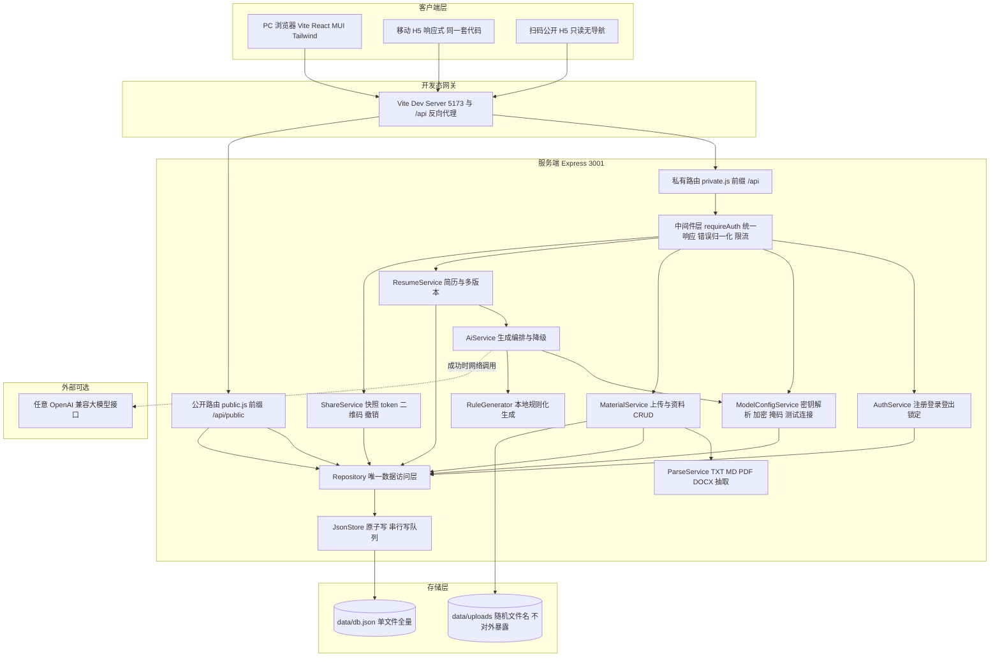
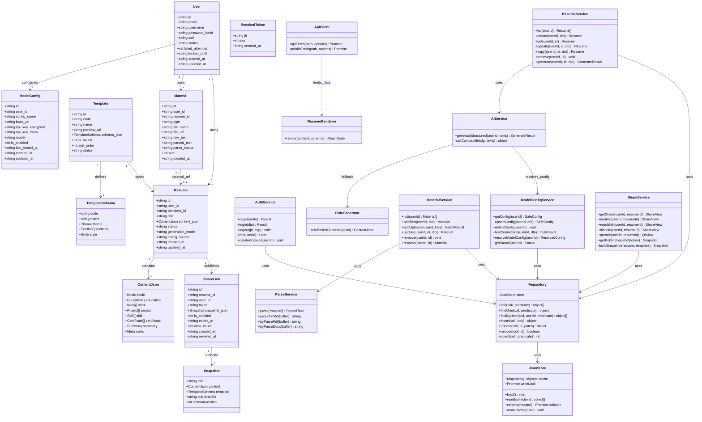
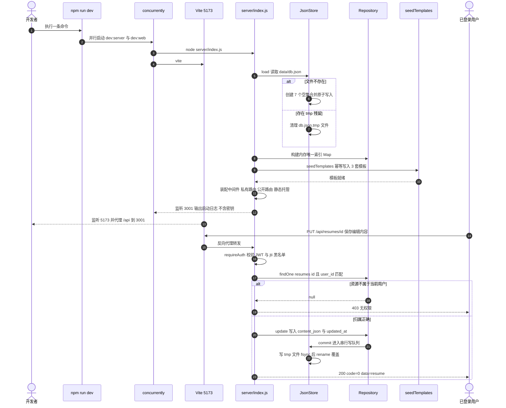
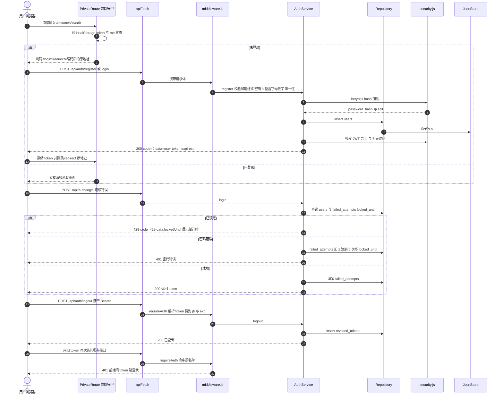
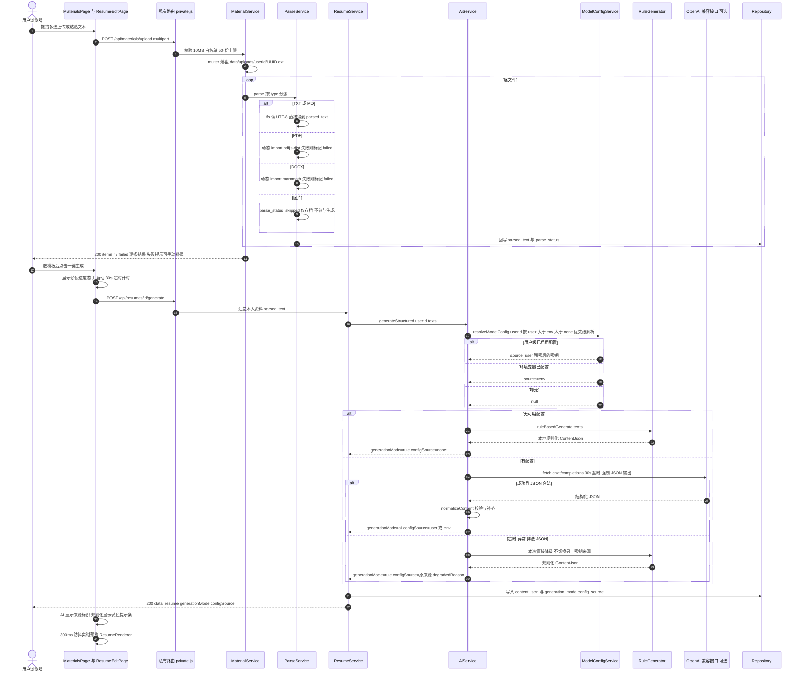
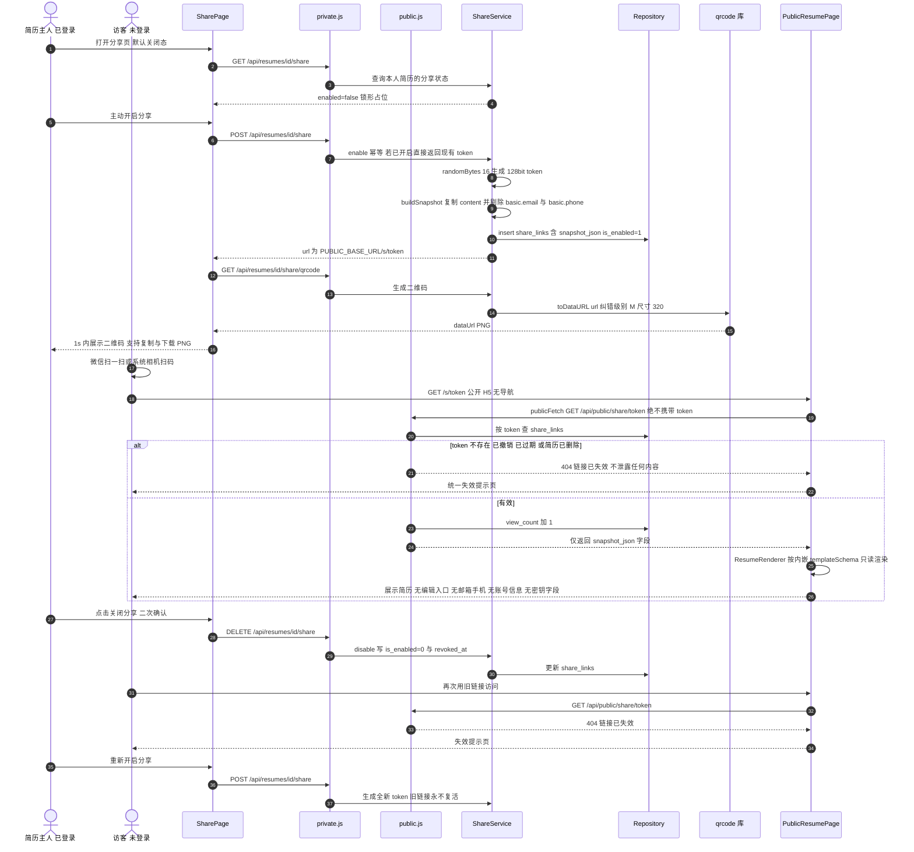
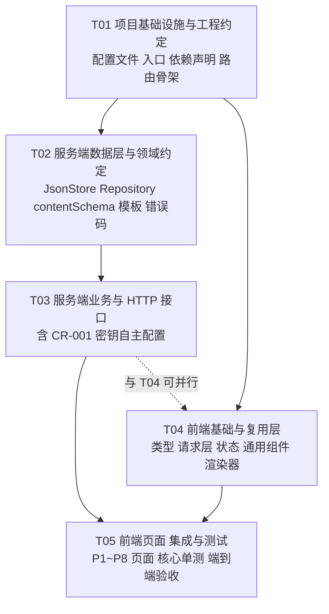

# 简历生成 Agent（resume_agent）系统架构设计与任务分解

> 文档版本 **v1.1**（对齐 CR-001 口径修订）｜ 架构师：高见远 ｜ 全篇简体中文
> 需求基线：`docs/01-PRD.md` v1.0 ｜ **合并增量**：`docs/01-PRD-ADDENDUM.md`（CR-001 v1.1）
> 本期编码范围：**P0 MVP 核心闭环 + CR-001「大模型密钥自主配置」（P0，本期 MVP 内消化）**
> 最高工程约束：**Windows 环境下 `npm install` 一次成功、`npm run dev` 一条命令启动、`npm test` 零配置可跑**

---

## 0. 范围与基线说明

### 0.1 基线合并说明（重要）

主理人下发的 PRD 原文为 `01-PRD.md` v1.0。经核查，同目录已存在产品经理正式产出的 `01-PRD-ADDENDUM.md`（CR-001 v1.1 增量 PRD），其中明确声明「**影响版本：本期 MVP 内消化（不新增版本、不延期）**」，且 R-031~R-035 全部定级 **P0**、交付判据 AC-01~AC-08 纳入 MVP 验收、并设有「第 8 节 给架构师的增量提醒」。该增量不改变核心闭环形态、不新增端侧、不改动 P2 发布边界，因此**并入本期设计不违背「本期编码范围严格限定 P0 MVP」的编排约束**；反之，若忽略它，工程师的实现与后续验收将必然脱节。

本设计以 v1.0 为基线，CR-001 作为覆盖性修订执行（冲突处以 CR-001 为准）。CR-001 对架构的 8 项实质影响：

| # | 影响点 | v1.0 基线 | 本设计采用（CR-001） |
| --- | --- | --- | --- |
| 1 | 密钥来源 | 仅开发者环境变量 | **双来源**：用户级（设置页，最高优先）+ 环境变量（次优先）+ 均无则规则化降级 |
| 2 | 环境变量名 | `AI_BASE_URL/AI_API_KEY/AI_MODEL` | **`LLM_BASE_URL` / `LLM_API_KEY` / `LLM_MODEL` / `LLM_TIMEOUT`**，另加 `MODEL_CONFIG_SECRET` |
| 3 | 生成响应 | 仅 `mode` | **`generationMode`（ai/rule）+ `configSource`（user/env/none）**，界面与响应一致、禁止错标 |
| 4 | 新实体 | 5 个实体 | 新增 **`ModelConfig`**（类图按 `User 1:N` 表达）；`Resume` 增加 `generation_mode` / `config_source` 留痕 |
| 5 | 密钥安全 | 未涉及 | **AES-256-GCM 加密存储**（密钥取服务端 env，不入库）、末 4 位掩码回显、明文不落日志/错误体/公开响应 |
| 6 | 新接口 | 无 | **`/api/settings/llm`（GET/PUT/DELETE）+ `POST /api/settings/llm/test`**，测试连接 10s 超时、不落库不生成简历 |
| 7 | 新页面 | P1~P7 共 7 页 | **P8「设置 → 模型配置」**；P4 顶部新增生成来源标识条；用户下拉新增「设置」入口 |
| 8 | 失败降级语义 | 密钥缺失才降级 | **选定来源调用失败/超时 30s 也降级**，且**不自动切换另一密钥来源**（避免账单归属混淆） |

### 0.2 本期交付边界

| 范围 | 本期实现（P0） | 本期不实现（仅预留接口/目录） |
| --- | --- | --- |
| 账号 | 注册/登录/登出/JWT/5 次锁定/登录态保持/路由守卫/账号注销级联清理 | 找回密码、邮箱验证、第三方登录（P2） |
| 资料 | 文本粘贴、TXT/MD/PDF/DOCX 抽取、图片仅存档、增删改查列表、重新解析 | 图片 OCR（P1）、原文件下载接口（P1） |
| 模板 | 内置 3 套（简约/专业/创意）schema 驱动渲染、切换内容不丢 | ≥6 套 + 主色字号自定义、可视化编辑器（P1/P2） |
| 生成 | **双来源密钥解析 + AI 生成 + 无密钥/失败规则化降级 + 进度态 + 来源标识 + 测试连接** | 重新生成/局部重写/版本对比、JD 优化、评分（P1/P2） |
| 简历 | 预览手动编辑、300ms 防抖实时预览、草稿/定稿、多版本、列表 | 服务端无头导出 PDF（P1，MVP 用浏览器打印兜底） |
| 分享 | token 链接、二维码 PNG、快照发布、撤销失效、免登录只读公开页、访问计数 | 有效期/访问趋势/二维码美化（P1） |
| 端侧 | PC 完整闭环 + 移动 H5 响应式（375~1920px）+ 公开 H5 | Taro 小程序编译、PWA/APP 壳、APP 安装包与商店上架、小程序审核发布（P1/P2） |
| 存储 | 单机 JSON 原子持久化 + 本地 uploads，零外部服务 | 云端 DB / 对象存储 / 多实例部署（后续迁移路径） |

### 0.3 技术选型总览

| 层 | 选型 | 一句话理由 |
| --- | --- | --- |
| 前端 | Vite 5 + React 18 + TypeScript + MUI 5 + Tailwind 3 + React Router 6 | 遵循默认栈，Vite 原生处理 TS，零额外编译链 |
| 状态 | React Context + `localStorage`（**不引入状态库**） | 仅登录态需要全局共享，零依赖最稳 |
| 服务端 | Node.js 18+ ESM + Express 4（**纯 JS，不引入 tsx/ts-node**） | 后端免编译，`node server/index.js` 直接启动 |
| 持久化 | **自研纯 JS JSON 原子持久化层**（`JsonStore` + 串行写队列） | Windows 零编译、零外部服务、单文件全量一致 |
| 数据访问 | 单一 `Repository` 层（依赖倒置） | 未来换 SQLite / 云端 DB 只换 Store 实现 |
| 密码 | `bcryptjs`（纯 JS 的 bcrypt 实现） | 满足 PRD「bcrypt 加盐哈希」且避开原生编译 |
| 会话 | `jsonwebtoken` + `jti` 黑名单集合 | 满足「登出旧 token 立即 401」 |
| 上传 | `multer` + 本地磁盘随机文件名 | 纯 JS，白名单 + 10MB + 路径防穿越 |
| 解析 | TXT/MD 内置；`pdfjs-dist` / `mammoth` 作为 **optionalDependencies 动态 import** | 系统级依赖为零，运行失败自动降级为「解析失败，可手动补录」 |
| AI | **Node 内置 `fetch` 调 OpenAI 兼容协议（不装任何 SDK）** | 厂商无关、零依赖、缺密钥不发网络请求 |
| 二维码 | `qrcode`（服务端生成 dataURL） | 纯 JS，前端 `` + `<a download>` 即可展示/下载 |
| 测试 | Node 内置 `node:test` + `node:assert/strict` | 零依赖，`npm test` 直接可跑 |
| 并行启动 | `concurrently`（devDependency） | 跨平台一条命令同时起 Vite 与 Express |
| 密钥加解密 | **Node 内置 `crypto`（AES-256-GCM）** + `dotenv` 读环境变量 | 二者均零编译、零系统依赖，满足 Windows 一次安装成功 |

### 0.4 v1.1 修订记录（对齐主理人两条口径指令）

> 本节为对 v1.0 的**覆盖性修订清单**，全文其余章节已同步改到位；冲突一律以本节与 CR-001 增量 PRD 为准。

| # | 变更点 | v1.0 旧值 | v1.1 采用值（本次指令） |
| --- | --- | --- | --- |
| M-01 | 生成模式字段口径 | 主理人首条消息曾提 `generationMode: "ai" \| "fallback"` | **该说法作废**；统一 `generationMode = "ai" \| "rule"`，并同时返回 `configSource = "user" \| "env" \| "none"`；降级原因走 `degradedReason` |
| M-02 | 配置接口路径 | `/api/model-config`（含 `/status`） | **统一为 `/api/settings/llm`（GET/PUT/DELETE）+ `/api/settings/llm/test`（POST）**；原 `/status` 语义并入 GET 响应的 `effectiveSource` 字段 |
| M-03 | 前端设置页路由 | `/settings/model` | **`/settings/llm`** |
| M-04 | 类图实体关系 | `User "1" --> "0..1" ModelConfig` | **`User "1" --> "*" ModelConfig : configures`**（与 CR-001 M-08 一致）；MVP 以 `unique(user_id)` 约束每用户 1 套，P1 R-036 放开多套 |
| M-05 | 加解密工具 | 并入 `server/utils/security.js` | **独立新增 `server/utils/crypto.js`**（#43，T03）：AES-256-GCM 加解密、掩码、加密密钥派生；`security.js` 回归认证原语，职责更单一 |
| M-06 | 本期文件数 | 42 | **43**（新增 #43 加解密工具） |
| M-07 | 共享知识补强 | 分散表述 | 集中补入：配置优先级解析规则、密钥掩码规则、`generationMode/configSource` 字段约定、`LLM_*` 环境变量「缺失即降级」判定、写入与测试接口鉴权 + `user_id` 隔离、前端 `type="password"`、`/api/public/*` 与二维码接口绝不返回任何配置字段 |
| M-08 | 依赖包说明 | 未点名加解密包 | 明确：加解密用 **Node 内置 `crypto`**（零依赖零编译），环境变量用 **`dotenv`**（纯 JS）；不引入任何原生编译模块 |

> 已确认沿用不变：`resolveModelConfig(userId)` 为服务端**单一密钥解析入口**（业务只消费解析结果，前端不传递/不拼接密钥）；优先级 `user > env > none`；选定来源调用失败/超时 30s **本次直接降级且不自动切换来源**；用户删除配置后回落 `env`；AC-01~AC-08 与厂商无关约束全部成立。

---

# Part A · 系统架构设计

## 1. 实现思路（Implementation Approach）

### 1.1 六个核心技术难点

| 难点 | 影响 | 应对策略 |
| --- | --- | --- |
| D1 Windows 原生模块编译失败 | `better-sqlite3` / `sqlite3` / `bcrypt` / `argon2` 均需 node-gyp + VS Build Tools，一条 `npm install` 失败即 demo 无法启动 | 全链路纯 JS 依赖 + 自研 JSON 原子持久化；密码用 `bcryptjs`；**零 native 依赖** |
| D2 无密钥 demo 必须 100% 可跑（含 CR-001 强化） | 任何环境（无环境变量、无用户配置、模型超时/异常）都不能中断闭环 | 生成采用 **Strategy + Fallback Orchestrator**：`resolveModelConfig()` 单一入口 → AI 适配器 / 规则适配器；失败直接降级且不换源 |
| D3 隐私隔离与越权 | 私有资源被改 ID 越权、公开页泄露邮箱手机、快照泄露草稿 | 私有/公开**双路由物理隔离**；所有私有查询强制 `user_id` 过滤；分享用**脱敏快照**（剔除 `basic.email/phone`）；公开接口只返回快照字段 |
| D4 资料与简历解耦 | 删除资料破坏已生成简历 | 生成时把 `parsed_text` **复制**进 `content_json`，`Material.resume_id` 可空，删除 Material 不触碰 Resume |
| D5 模板可扩展且不改业务代码 | 每加一套模板要改渲染逻辑 | `schema_json`（theme/style/sections）驱动唯一 `ResumeRenderer`，新增模板 = 新增一条配置 |
| D6 多端复用与单仓一条命令 | 前后端分离需两次启动、小程序需另一套代码 | 单 `package.json` + Vite `/api` 代理 + `concurrently`；`src/types`、`src/api`、`ResumeRenderer` 保持与框架无关，便于 P1 Taro 复用 |

### 1.2 关键决策一：零编译持久化（明确决策与理由）

> **决策：本期采用「纯 JS JSON 原子持久化层」（`data/db.json` 单文件），不采用任何 SQLite 实现。**

| 候选 | 是否采用 | 判定理由 |
| --- | --- | --- |
| `better-sqlite3` / `sqlite3` | ❌ 排除 | 原生模块，Windows 需 Python + VS Build Tools，`npm install` 极易失败，直接违反最高工程约束 |
| `node:sqlite`（Node ≥22 内置） | ❌ 本期排除 | 版本门槛高（要求用户预装 Node 22）、仍属 experimental 且启动有告警；列入后续迁移路径 |
| `sql.js`（WASM） | ❌ 本期排除 | 需自行管理 DB 二进制导出/回写与 WASM 加载，收益低于复杂度；列入后续迁移路径 |
| **纯 JS JSON 原子持久化** | ✅ **采用** | ① 零第三方依赖、零编译、Windows 100% 安装成功；② 无外部服务，`npm run dev` 即可跑；③ MVP 数据量小（单用户 ≤50 资料、简历版本个位数），全量读写性能足够；④ 单文件一次 `rename` 天然保证跨集合一致性；⑤ 数据人类可读，demo 排错极方便 |

配套的三个工程保障（必须实现，否则 JSON 方案不成立）：

1. **原子写**：写 `data/db.json.tmp-<uuid>` → `fsync` → `fs.renameSync` 覆盖，避免半写损坏；启动时若发现 `*.tmp-*` 残留则清理。
2. **进程内串行写队列**：`JsonStore` 内维护一个 Promise 写锁，所有 `insert/update/remove` 串行执行，读走内存快照，保证 PRD「≥20 并发基本可用」下不出现并发覆盖（这是 JSON 方案唯一的硬约束，写进 T02 验收点）。
3. **依赖倒置**：业务层只依赖 `Repository` 接口（`findOne/find/insert/update/remove/count`），`JsonStore` 是可替换实现；后续换 SQLite / 云端 DB 只改 `server/store/`，业务代码零改动。

> 明确限制（写进待明确事项）：本方案仅保证**单进程**内一致性，多实例/多进程部署不支持，需按第 7 节迁移。

### 1.3 关键决策二：纯 JS 依赖矩阵

- **PDF/DOCX 解析库优先纯 JS**：`pdfjs-dist`（Mozilla，JS+预置 WASM，无 node-gyp）、`mammoth`（纯 JS DOCX 转文本）。二者均放 `optionalDependencies` 并用**动态 `import()` + try/catch** 包裹：加载或解析失败时把该资料标记为 `parse_status=failed` + 「解析失败，可手动补录」，**绝不阻塞上传与生成闭环**（PRD R-006 允许失败标记）。
  - `pdfjs-dist` 在 Node 中运行若报 `DOMMatrix is not defined`，实现要点：使用 `pdfjs-dist/legacy/build/pdf.mjs` 且 `useWorkerFetch:false / disableWorker`，必要时注入最小 polyfill；仍失败即走降级，不引入 `canvas` 原生依赖。
  - `mammoth.extractRawText({ buffer })` 直接取文本，无需 HTML 清洗。
- **上传不引入静态暴露**：`data/uploads/` **不挂 `express.static`**，仅记录相对路径到 `file_url`，MVP 不提供原文件下载接口，杜绝未授权直链访问（PRD 隐私基线）。
- **AI 不引入 SDK**：用 Node 18+ 内置 `fetch` + `AbortSignal.timeout()` 直连 OpenAI 兼容 `/chat/completions`，天然厂商无关（CR-001 AC-08）。
- **后端不用 TypeScript**：Vite 侧 TS 由 esbuild 零配置处理；后端保持纯 JS ESM，避免 `tsx/ts-node` 带来的启动链复杂度。

### 1.4 关键决策三：生成双来源与策略降级（CR-001 核心）

```
resolveModelConfig(userId)  ← 服务端唯一密钥解析入口（禁止前端传递/拼接密钥）
   ├─ 用户级已启用配置 → { source:'user', ... }   ← 最高优先
   ├─ 环境变量已配置   → { source:'env',  ... }
   └─ 均无             → null                    → rule / none
generateStructured(userId, texts)
   ├─ null              → ruleBasedGenerate() → { generationMode:'rule', configSource:'none' }
   ├─ 调 AI 成功        → normalizeContent() → { generationMode:'ai',   configSource: source }
   └─ 失败/超时 30s/非法 JSON → ruleBasedGenerate()
                          → { generationMode:'rule', configSource: source, degradedReason }
                            （★ 不自动切换到另一密钥来源，仅本次降级）
```

- `generationMode` 表示**实际生成方式**，`configSource` 表示**本次解析到的配置来源**，二者正交，四态组合见 5.4 节。
- 选定来源的配置在**服务端解密**后使用，明文只存在于本次请求内存，绝不写入简历记录、日志、错误体或任何响应。
- 规则化生成器 `ruleGenerator.js` 为纯本地实现（正则抽取邮箱/手机/日期、教育/公司/职位/技能关键词词库、按行分段填充 7 个分区），**零网络请求**，是 AC-01 无密钥闭环 100% 通过的最终保障。

### 1.5 关键决策四：隐私与权限基线

| 机制 | 实现 |
| --- | --- |
| 私有接口归属 | `requireAuth` 注入 `req.user.id`；所有查询/更新/删除必须带 `user_id` 条件，不匹配返回 403（不是 404，便于明确拒绝） |
| 公开接口隔离 | `server/routes/public.js` **独立文件、独立前缀 `/api/public`、不挂任何鉴权中间件、不 import 任何私有 service**，只读 `ShareLink.snapshot_json` |
| 快照脱敏 | 发布时 `buildSnapshot()` 生成 `{title, content(已剔除 basic.email/basic.phone), templateSchema, publishedAt, schemaVersion}`；不含 user_id / file_url / raw_text / 任何密钥字段 |
| 分享撤销 | `is_enabled=0` + `revoked_at`；公开查询统一按 5.3 节失效判定返回 404「链接已失效」；重新开启**生成新 token** |
| 登出失效 | `jti` 写入 `revoked_tokens` 集合，`requireAuth` 校验黑名单；过期项按 `exp` 惰性清理 |
| 账号锁定 | `users.failed_attempts` + `locked_until`，连续 5 次错误锁 5 分钟，返回 429 + `data.lockedUntil` |
| 密钥安全 | AES-256-GCM（Node 内置 `crypto`，密钥来自 `MODEL_CONFIG_SECRET` 或由 `JWT_SECRET` 派生）；掩码 `sk-****************3f9a`；`ModelConfig` 全部接口私有且按 `user_id` 隔离，跨用户 403 |

### 1.6 架构模式与分层

- **前端**：Container / Presentational 分离（`pages` 只做数据编排与事件，`components` 只做展示），全局状态用 Context，网络收敛在 `src/api/client.ts`。
- **后端**：严格四层单向依赖 `Routes → Middleware → Services → Repository → Store`。禁止跨层反向依赖；`Repository` 是唯一数据出入口。
- **生成**：Strategy（AI 适配器 / Rule 适配器）+ Fallback Orchestrator；配置解析为单一入口 `resolveModelConfig(userId)`。
- **渲染**：Schema-Driven Rendering，模板即数据。
- **横切**：统一响应、错误归一化、限流、鉴权在 `server/middleware.js` 一处装配。

### 1.7 模块 / 分层架构图



> 图中 `PubRouter` 直连 `Repository` 且**只读取 `share_links.snapshot_json`**，与私有业务服务物理隔离；`LLM` 为虚线可选依赖，缺失时整条链路完全不发起网络请求。

---

## 2. 文件清单（File List）

> 本期实现 **43 个文件**（基线 v1.0 对应 40 个 + CR-001 新增 3 个：`modelConfigService.js`、`ModelConfigPage.tsx`、`server/utils/crypto.js`；CR-001 为 P0 且明确「本期 MVP 内消化」，故属必要最小上浮）。含 1 个测试文件（内部按 5 组 `describe` 组织）。每个文件职责单一。
> 表格末尾另列 6 个**预留文件（本期不实现）**，仅用于说明接口/目录预留，不进入工程师任务列表。

| # | 相对路径 | 类型 | 职责 | 所属任务 | 本期实现 |
| --- | --- | --- | --- | --- | --- |
| 1 | `package.json` | 配置 | 单一依赖声明与 `dev/build/test` 脚本，`type:module` | T01 | ✅ |
| 2 | `vite.config.ts` | 配置 | React 插件、`/api` 代理到 3001、`@` alias、内联 PostCSS/Tailwind | T01 | ✅ |
| 3 | `tailwind.config.js` | 配置 | Tailwind content 扫描、主题色、关闭 preflight | T01 | ✅ |
| 4 | `index.html` | 入口 | Vite HTML 挂载点与中文 lang/meta | T01 | ✅ |
| 5 | `.env.example` | 配置 | 全部环境变量**占位符示例**（`LLM_*`、`MODEL_CONFIG_SECRET` 等，无任何真实密钥） | T01 | ✅ |
| 6 | `.gitignore` | 配置 | 忽略 `node_modules/ dist/ data/ .env` | T01 | ✅ |
| 7 | `src/main.tsx` | 入口 | `createRoot` + `BrowserRouter` + MUI `ThemeProvider/CssBaseline` + 引入全局样式 | T01 | ✅ |
| 8 | `src/App.tsx` | 入口 | 路由表、`PrivateRoute`/公开路由守卫、Layout 包裹、登录回跳 | T01 | ✅ |
| 9 | `src/index.css` | 样式 | Tailwind 指令、CSS 变量、A4 预览与响应式基础样式 | T01 | ✅ |
| 10 | `server/store/jsonStore.js` | 数据 | JSON 原子读写、内存快照、Promise 串行写队列、tmp 残留清理 | T02 | ✅ |
| 11 | `server/store/collections.js` | 数据 | 7 个集合定义、默认值、唯一索引、启动 seed 入口 | T02 | ✅ |
| 12 | `server/store/repository.js` | 数据 | **唯一数据访问层** `find/findOne/insert/update/remove/count`，强制 `user_id` 过滤辅助 | T02 | ✅ |
| 13 | `server/domain/contentSchema.js` | 领域 | `content_json` 完整 Schema、空简历、`SAMPLE_CONTENT`、`normalizeContent()` | T02 | ✅ |
| 14 | `server/domain/templates.js` | 领域 | 3 套内置模板 `schema_json` 具体配置 + `seedTemplates()` | T02 | ✅ |
| 15 | `server/domain/contracts.js` | 领域 | 全局常量、错误码表、`AppError`、状态/模式枚举（含 `generationMode`/`configSource`） | T02 | ✅ |
| 16 | `server/index.js` | 入口 | 读 env、初始化 Store/Repository/seed、Express app 装配、静态托管 `dist`、SPA fallback、listen | T03 | ✅ |
| 17 | `server/middleware.js` | 中间件 | `res.ok/res.fail`、`asyncHandler`、错误归一化、内存限流、`requireAuth`（JWT + jti 黑名单） | T03 | ✅ |
| 18 | `server/utils/security.js` | 工具 | bcrypt 哈希/校验、JWT 签发/验证（含 jti）、128bit 高熵 token、公开 URL 拼装（**密钥加解密已拆至 #43**） | T03 | ✅ |
| 19 | `server/services/authService.js` | 服务 | 注册/登录/登出/me/注销、密码强度校验、5 次锁定、jti 黑名单、级联清理 | T03 | ✅ |
| 20 | `server/services/modelConfigService.js` | 服务 | **CR-001 用户级 LLM 配置模块**：`/api/settings/llm` 的配置 CRUD（调 #43 加密/掩码）、**单一入口 `resolveModelConfig(userId)`** 优先级解析、测试连接 10s、生效来源查询、按 `user_id` 归属隔离 | T03 | ✅ |
| 21 | `server/services/materialService.js` | 服务 | multer 落盘配置（白名单/10MB/随机名）、资料 CRUD、50 份上限、触发解析 | T03 | ✅ |
| 22 | `server/services/parseService.js` | 服务 | TXT/MD 内置抽取、PDF/DOCX 可选库动态 import 降级、图片跳过、`parse_status` 回写 | T03 | ✅ |
| 23 | `server/services/aiService.js` | 服务 | `generateStructured()` 编排：**只消费 `resolveModelConfig()` 解析结果**、OpenAI 兼容 fetch（≤30s）、JSON 校验、失败降级不换源、返回 `generationMode/configSource/degradedReason` | T03 | ✅ |
| 24 | `server/services/ruleGenerator.js` | 服务 | 纯本地关键词/正则规则化生成，填充 7 分区，保证无密钥 100% 可读产出 | T03 | ✅ |
| 25 | `server/services/resumeService.js` | 服务 | 简历 CRUD、另存版本、模板切换、生成落库并留痕 `generation_mode/config_source` | T03 | ✅ |
| 26 | `server/services/shareService.js` | 服务 | 分享开关幂等、128bit+ token、**脱敏快照**、撤销/重新发布、失效判定、`view_count`、二维码 dataURL | T03 | ✅ |
| 27 | `server/routes/private.js` | 路由 | 全部 `/api` 私有路由：auth / **settings/llm** / materials / templates / resumes / generate / share（全部挂 `requireAuth`） | T03 | ✅ |
| 28 | `server/routes/public.js` | 路由 | **独立公开路由** `/api/public/share/:token`，无鉴权、只返回快照、绝不 import 私有 service | T03 | ✅ |
| 29 | `src/types/index.ts` | 类型 | 共享类型：User/Material/Resume/Template/ShareLink/**ModelConfig**/ContentJson/ApiResponse/枚举 | T04 | ✅ |
| 30 | `src/api/client.ts` | 请求 | `apiFetch`（Bearer + 解包 + 401 跳登录回跳）与 `publicFetch`（**绝不携带 token**） | T04 | ✅ |
| 31 | `src/store/authStore.tsx` | 状态 | React Context 登录态、token/用户信息持久化、login/logout/refreshMe | T04 | ✅ |
| 32 | `src/components/shell.tsx` | 组件 | 四类状态组件、ConfirmDialog 二次确认、Toast、表单字段、顶部/侧导航、用户下拉（含「设置」）、生成来源标识条 | T04 | ✅ |
| 33 | `src/components/ResumeRenderer.tsx` | 组件 | 按 `template.schema_json` 渲染 `content_json` 为 A4 简历；编辑预览、模板缩略、公开页共用 | T04 | ✅ |
| 34 | `src/pages/AuthPage.tsx` | 页面 | P1 登录/注册 Tab、密码显隐、校验、锁定倒计时、成功回跳 | T05 | ✅ |
| 35 | `src/pages/MaterialsPage.tsx` | 页面 | P2 拖拽/多选上传、粘贴框、资料卡片 CRUD、解析状态、重新解析、进度与超限提示 | T05 | ✅ |
| 36 | `src/pages/TemplatesPage.tsx` | 页面 | P3 模板网格、缩略预览、预览弹窗、使用此模板、当前模板角标 | T05 | ✅ |
| 37 | `src/pages/ResumeEditPage.tsx` | 页面 | P4 左编辑右预览/移动 Tab、分区折叠增删改排序、300ms 防抖、生成进度、**来源标识条**、保存/另存/去分享 | T05 | ✅ |
| 38 | `src/pages/ResumesPage.tsx` | 页面 | P5 简历列表、搜索/状态筛选、新建/重命名/删除/设为当前、分享状态标识 | T05 | ✅ |
| 39 | `src/pages/SharePage.tsx` | 页面 | P6 分享开关、链接复制、二维码展示与 PNG 下载、风险提示、关闭二次确认 | T05 | ✅ |
| 40 | `src/pages/PublicResumePage.tsx` | 页面 | P7 免登录只读、无导航无编辑入口、失效统一提示页、骨架屏 | T05 | ✅ |
| 41 | `src/pages/ModelConfigPage.tsx` | 页面 | **P8 CR-001** 路由 `/settings/llm`「设置 → 模型配置」：来源状态条、`api_key` 用 `type="password"` + 显隐 + 掩码回显、启用开关、测试连接（10s 返回耗时）、保存/删除二次确认、风险提示文案、表单校验禁用保存 | T05 | ✅ |
| 42 | `server/tests/core.test.js` | 测试 | 5 组 `describe`：Store 原子写与并发、Auth 与锁定、规则化降级、**CR-001 优先级/回落/不换源/密钥加密与掩码**、分享快照与撤销失效 | T05 | ✅ |
| 43 | `server/utils/crypto.js` | 工具 | **CR-001 独立加解密工具**：Node 内置 `crypto` 的 AES-256-GCM 加密/解密（随机 IV + tag）、`mask()` 掩码、由 `MODEL_CONFIG_SECRET` 或 `JWT_SECRET` 派生加密密钥；明文不出口 | T03 | ✅ |
| — | `server/store/sqliteRepository.js` | 预留 | 后续替换为 Node 22 `node:sqlite` 实现，`Repository` 接口不变 | — | ❌ 本期不实现 |
| — | `server/services/ocrService.js` | 预留 | P1 图片 OCR，缺失时仅存档 | — | ❌ 本期不实现 |
| — | `server/services/exportService.js` | 预留 | P1 服务端无头 PDF 导出，MVP 用浏览器打印兜底 | — | ❌ 本期不实现 |
| — | `server/routes/generateStream.js` | 预留 | P1 SSE 生成进度，MVP 用同步请求 + 前端阶段进度 | — | ❌ 本期不实现 |
| — | `miniapp/` | 预留 | P1 Taro 工程（复用 `src/types` 与请求层适配），公开查看走 web-view 承载 H5 | — | ❌ 本期不实现 |
| — | `public/manifest.webmanifest` + `public/sw.js` | 预留 | P1 PWA / APP 壳 | — | ❌ 本期不实现 |

---

## 3. 数据结构与接口（Data Structures and Interfaces）

### 3.1 类图（数据模型 + 服务类 + 关系）



### 3.2 集合字段与索引

> `data/db.json` 单文件结构：`{ "users":[], "resumes":[], "materials":[], "templates":[], "share_links":[], "model_configs":[], "revoked_tokens":[] }`。
> JSON Store 不提供原生索引：`Repository` 启动时在内存为「唯一键」构建 `Map`，写入时同步维护，重复即抛 `409`。所有时间统一 **ISO 8601 UTC 字符串**。

| 集合 | 字段 | 唯一/查询索引 | 说明 |
| --- | --- | --- | --- |
| `users` | `id, email, username, password_hash, salt, status(active/locked), failed_attempts, locked_until, created_at, updated_at` | **unique(email)**、**unique(username)**、`id` | 后 3 个字段为 R-002 锁定需求对 PRD 实体的必要扩展 |
| `resumes` | `id, user_id, template_id, title, content_json, status(draft/final), generation_mode, config_source, created_at, updated_at` | `id`、**idx(user_id, updated_at desc)** | 后 2 个字段为 CR-001 M-08 留痕，不含密钥 |
| `materials` | `id, user_id, resume_id(nullable), type, file_name, file_url, raw_text, parsed_text, parse_status(pending/success/failed/skipped), size, created_at` | `id`、**idx(user_id, created_at desc)** | 删除不影响 `resumes.content_json` |
| `templates` | `id, code, name, preview_url, schema_json, is_builtin, sort_order, status` | **unique(code)** | 启动时由 `seedTemplates()` 幂等写入 3 套 |
| `share_links` | `id, resume_id, user_id, token, snapshot_json, is_enabled, expire_at(nullable), view_count, created_at, revoked_at` | **unique(token)**、**idx(resume_id, is_enabled)** | 公开页只凭有效 token 读 `snapshot_json` |
| `model_configs` | `id, user_id, config_name, base_url, api_key_encrypted, api_key_mask, model, is_enabled, last_tested_at, created_at, updated_at` | **idx(user_id, is_enabled)** + MVP 额外约束 `unique(user_id)`（每用户 1 套启用）；**类图按 `User 1:N ModelConfig` 表达**，P1 R-036 放开多套时仅需去掉唯一约束、改查询取 `is_enabled=1` 的一条，表结构零改动 | `api_key_encrypted` 为 AES-256-GCM 密文（含随机 IV 与 tag），**库中永无明文**；`api_key_mask` 仅末 4 位；所有读写按 `user_id` 强制过滤，跨用户 403 |
| `revoked_tokens` | `jti, exp, created_at` | **unique(jti)** | 登出黑名单，`exp` 过期后惰性清理 |

**目录与命名约定**

```
data/
  db.json                                  # 单文件全量数据（原子替换写入）
  db.json.tmp-<uuid>                       # 原子写临时文件，启动清理
  uploads/<userId>/<randomUUID>.<safeExt>  # 原始上传文件，随机名，不对外静态暴露
src/
  main.tsx App.tsx index.css
  api/         # 请求层（唯一出网口）
  store/       # 全局状态
  types/       # 共享类型（跨端复用）
  components/  # 通用组件 / 布局 / 简历渲染器
  pages/       # 8 个页面
server/
  index.js middleware.js
  store/ domain/ services/ routes/ utils/ tests/
```

- 所有 `id` 用 `crypto.randomUUID()`；分享 `token` 用 `crypto.randomBytes(16).toString('base64url')`（**≥128bit 高熵**）。
- 上传扩展名白名单：`.txt .md .pdf .docx .doc .png .jpg .jpeg .webp`；落盘文件名一律用 UUID，**绝不拼接用户传入的 file_name**，防路径穿越与脚本执行。
- `file_url` 只存相对路径字符串（如 `data/uploads/<uid>/<uuid>.pdf`），不含公网 URL。

### 3.3 `content_json` 完整 JSON Schema

> 7 个业务分区 + `meta`。**数组顺序即展示/排序顺序**，前端拖拽改数组顺序即可，无需 `order` 字段；每个数组元素带 `id` 作为稳定 React key。所有字段可空字符串/空数组，`normalizeContent()` 对任意残缺输入补齐结构且绝不抛错。

| 分区 | 字段 | 类型 | 示例 | 说明 |
| --- | --- | --- | --- | --- |
| `basic` | `name` | string | `"张明"` | 姓名 |
| | `gender` | string | `"男"` | 性别，可空 |
| | `birthDate` | string | `"1998-05"` | YYYY-MM 或 YYYY-MM-DD |
| | `phone` | string | `"13800138000"` | **分享快照中剔除** |
| | `email` | string | `"zhang@example.com"` | **分享快照中剔除** |
| | `location` | string | `"深圳"` | 现居地 |
| | `jobTarget` | string | `"前端工程师"` | 求职意向 |
| | `avatarUrl` | string | `""` | MVP 不上传头像，留空 |
| | `links` | `{label,url}[]` | `[{"label":"GitHub","url":"https://..."}]` | 个人链接 |
| `education[]` | `id, school, degree, major, startDate, endDate, description` | string | `{"id":"e1","school":"XX大学","degree":"本科","major":"计算机","startDate":"2016-09","endDate":"2020-06","description":""}` | 教育经历 |
| `work[]` | `id, company, position, location, startDate, endDate, highlights[]` | string / string[] | `{"id":"w1","company":"XX科技","position":"前端工程师","highlights":["负责 A 系统重构"]}` | 工作经历 |
| `project[]` | `id, name, role, startDate, endDate, description, highlights[], link` | string / string[] | `{"id":"p1","name":"简历 Agent","role":"负责人","highlights":["独立完成"]}` | 项目经历 |
| `skill[]` | `id, category, items[], level` | string / string[] | `{"id":"s1","category":"前端","items":["React","TypeScript"],"level":"熟练"}` | 技能 |
| `certificate[]` | `id, name, issuer, date, description` | string | `{"id":"c1","name":"CET-6","issuer":"教育部","date":"2019-06"}` | 证书 |
| `summary` | `content` | string | `"5 年前端开发经验..."` | 自我评价正文 |
| | `highlights[]` | string[] | `["主导 3 个项目"]` | 亮点条目 |
| `meta` | `schemaVersion` | int | `1` | 结构版本，便于后续演进 |
| | `generatedMode` | enum | `"ai" / "rule" / "manual"` | 与生成响应一致 |
| | `configSource` | enum | `"user" / "env" / "none"` | CR-001 留痕 |
| | `updatedAt` | string | ISO 8601 UTC | 最后更新时间 |

**可直接照抄的空结构**（`server/domain/contentSchema.js` 导出 `EMPTY_CONTENT`）：

```js
export const EMPTY_CONTENT = {
  basic: { name: '', gender: '', birthDate: '', phone: '', email: '',
           location: '', jobTarget: '', avatarUrl: '', links: [] },
  education: [], work: [], project: [], skill: [], certificate: [],
  summary: { content: '', highlights: [] },
  meta: { schemaVersion: 1, generatedMode: 'manual', configSource: 'none', updatedAt: '' }
};
// SECTION_KEYS = ['basic','education','work','project','skill','certificate','summary']
// normalizeContent(input): 深合并 EMPTY_CONTENT，数组元素补 id，字符串字段强制转 string，
//                          丢弃未知字段，返回合法结构（永不抛错）
// SAMPLE_CONTENT: 用于模板缩略图渲染的示例数据（不含任何真实个人信息、不含密钥）
```

### 3.4 模板 `schema_json` 结构与 3 套内置配置

**结构定义**

| 字段 | 类型 | 说明 |
| --- | --- | --- |
| `code` | string | 唯一标识，与 `templates.code` 一致 |
| `name` / `description` / `tags[]` | string / string[] | 展示名称、适用场景、标签 |
| `preview_url` | string | MVP 固定 `""`，缩略图由前端 `ResumeRenderer` 渲染 `SAMPLE_CONTENT` 生成（不引入图片资源）；P1 可换真实图 |
| `theme` | `{primary, text, muted, bg, accent}` | 主色/正文/次要/背景/强调色，均 HEX |
| `style` | `{fontFamily, baseFontSize, lineHeight, sectionGap, radius, headerLayout, density, showAvatar}` | 字号 px、行高、分区间距 px、圆角 px、页头布局 `left/center/banner`、密度 `compact/normal`、是否显示头像位 |
| `sections[]` | `{key, title, enabled, order, layout}[]` | 分区开关、顺序、布局 `inline/list/cards/text`；**渲染器只遍历 sections，不改代码即可扩充模板** |

**3 套内置模板具体配置值**（`server/domain/templates.js` 直接照抄）：

```js
export const BUILTIN_TEMPLATES = [
  {
    code: 'simple', name: '简约', description: '清爽通用，适合应届生与大多数岗位',
    tags: ['通用', '应届生'], preview_url: '', is_builtin: 1, sort_order: 1, status: 'active',
    schema_json: {
      code: 'simple', name: '简约', description: '清爽通用，适合应届生与大多数岗位',
      tags: ['通用', '应届生'], preview_url: '',
      theme: { primary: '#2563EB', text: '#1F2937', muted: '#6B7280', bg: '#FFFFFF', accent: '#EFF6FF' },
      style: { fontFamily: '"PingFang SC","Microsoft YaHei",sans-serif', baseFontSize: 14,
               lineHeight: 1.6, sectionGap: 16, radius: 4, headerLayout: 'left',
               density: 'normal', showAvatar: false },
      sections: [
        { key: 'basic',       title: '基本信息', enabled: true, order: 1, layout: 'inline' },
        { key: 'education',   title: '教育经历', enabled: true, order: 2, layout: 'list'  },
        { key: 'work',        title: '工作经历', enabled: true, order: 3, layout: 'list'  },
        { key: 'project',     title: '项目经历', enabled: true, order: 4, layout: 'list'  },
        { key: 'skill',       title: '技能专长', enabled: true, order: 5, layout: 'cards' },
        { key: 'certificate', title: '证书荣誉', enabled: true, order: 6, layout: 'list'  },
        { key: 'summary',     title: '自我评价', enabled: true, order: 7, layout: 'text'  }
      ]
    }
  },
  {
    code: 'pro', name: '专业', description: '稳重深蓝，工作经历优先，适合社招与中高级岗位',
    tags: ['社招', '管理岗'], preview_url: '', is_builtin: 1, sort_order: 2, status: 'active',
    schema_json: {
      code: 'pro', name: '专业', description: '稳重深蓝，工作经历优先，适合社招与中高级岗位',
      tags: ['社招', '管理岗'], preview_url: '',
      theme: { primary: '#1E3A5F', text: '#111827', muted: '#6B7280', bg: '#FFFFFF', accent: '#E8EEF6' },
      style: { fontFamily: '"PingFang SC","Microsoft YaHei",sans-serif', baseFontSize: 13.5,
               lineHeight: 1.55, sectionGap: 14, radius: 2, headerLayout: 'center',
               density: 'compact', showAvatar: true },
      sections: [
        { key: 'basic',       title: '基本信息', enabled: true, order: 1, layout: 'inline' },
        { key: 'summary',     title: '职业概述', enabled: true, order: 2, layout: 'text'  },
        { key: 'work',        title: '工作经历', enabled: true, order: 3, layout: 'list'  },
        { key: 'project',     title: '项目经历', enabled: true, order: 4, layout: 'list'  },
        { key: 'education',   title: '教育背景', enabled: true, order: 5, layout: 'list'  },
        { key: 'skill',       title: '专业技能', enabled: true, order: 6, layout: 'cards' },
        { key: 'certificate', title: '资格证书', enabled: true, order: 7, layout: 'list'  }
      ]
    }
  },
  {
    code: 'creative', name: '创意', description: '紫色强调色与卡片布局，适合设计、内容与创意岗位',
    tags: ['设计', '创意'], preview_url: '', is_builtin: 1, sort_order: 3, status: 'active',
    schema_json: {
      code: 'creative', name: '创意', description: '紫色强调色与卡片布局，适合设计、内容与创意岗位',
      tags: ['设计', '创意'], preview_url: '',
      theme: { primary: '#7C3AED', text: '#1F2937', muted: '#7C7C8A', bg: '#FFFFFF', accent: '#F5F3FF' },
      style: { fontFamily: '"PingFang SC","Microsoft YaHei",sans-serif', baseFontSize: 15,
               lineHeight: 1.7, sectionGap: 20, radius: 12, headerLayout: 'banner',
               density: 'normal', showAvatar: true },
      sections: [
        { key: 'basic',       title: '关于我',   enabled: true, order: 1, layout: 'inline' },
        { key: 'skill',       title: '能力标签', enabled: true, order: 2, layout: 'cards' },
        { key: 'project',     title: '代表作品', enabled: true, order: 3, layout: 'cards' },
        { key: 'work',        title: '经历',     enabled: true, order: 4, layout: 'list'  },
        { key: 'education',   title: '教育',     enabled: true, order: 5, layout: 'list'  },
        { key: 'certificate', title: '荣誉',     enabled: true, order: 6, layout: 'list'  },
        { key: 'summary',     title: '自述',     enabled: true, order: 7, layout: 'text'  }
      ]
    }
  }
];
```

---

## 4. 程序调用流程（Program Call Flow）

### 4.1 应用启动初始化与简历 CRUD



### 4.2 注册、登录鉴权、锁定与登出



### 4.3 资料上传解析 + 生成（含 CR-001 优先级与降级）



### 4.4 分享发布 + 扫码公开查看 + 撤销失效



---

## 5. 完整 REST API 清单

> 统一响应体 `{code, message, data}`，`code=0` 成功。除 `register/login` 与 `/api/public/*` 外，所有私有接口必须携带 `Authorization: Bearer <token>`。
> 主要错误码列使用第 6.1 节错误码表；所有写操作经 `requireAuth` + `user_id` 归属过滤，跨用户一律 **403**。

### 5.1 私有 API（前缀 `/api`）

| 方法 | 路径 | 鉴权 | 请求体 / 参数 | 响应 `data` | 主要错误码 |
| --- | --- | --- | --- | --- | --- |
| POST | `/api/auth/register` | 否 | `{email, username, password, confirmPassword}` | `{user, token, expiresIn}` | 409 邮箱/用户名已存在、422 格式或强度不合格 |
| POST | `/api/auth/login` | 否 | `{account, password, rememberMe}` | `{user, token, expiresIn}` | 401 凭据错误、422 参数、429 锁定 5 分钟（附 `lockedUntil`） |
| POST | `/api/auth/logout` | 是 | 无（Bearer） | `{revoked:true}` | 401 |
| GET | `/api/auth/me` | 是 | 无 | `{user}`（不含 password_hash/salt） | 401 |
| DELETE | `/api/auth/me` | 是 | 无 | `{deleted:true}` 级联清理简历/资料/分享/配置/上传文件 | 401 |
| GET | `/api/settings/llm` | 是 | 无 | `{configured:boolean, config:{config_name, base_url, model, is_enabled, last_tested_at, api_key_mask}, effectiveSource:'user'/'env'/'none'}`；**不返回密文、不返回完整密钥、不返回任何环境变量密钥** | 401（未登录/token 失效）、403（跨用户）、404 未配置时返回 `configured:false` |
| PUT | `/api/settings/llm` | 是 | `{config_name, base_url, api_key, model, is_enabled}`；前端 `api_key` 输入框 `type="password"` | `{configured:true, config:{..., api_key_mask}, effectiveSource}` 掩码回显 | 401、403、422 校验（`base_url` 须 HTTPS 或 localhost、`api_key/model/config_name` 非空）、429 限流 |
| DELETE | `/api/settings/llm` | 是 | 无 | `{configured:false, effectiveSource:'env'/'none'}` 密文清除且不可恢复，回落环境变量或规则化生成 | 401、403、404 |
| POST | `/api/settings/llm/test` | 是 | `{config_name?, base_url, api_key?, model}`（未传 `api_key` 时用本人已存配置密文） | `{ok, latencyMs, message}`；失败给可读原因（密钥无效 / 接口地址不可达 / 超时），**不回显密钥明文**，不落库、不产生简历记录 | 401、403、422、429；500 超时 10s 归一化为可读失败（不回显堆栈） |
| GET | `/api/materials` | 是 | 无 | `{items:[Material], total}` 按 created_at 倒序 | 401 |
| POST | `/api/materials/text` | 是 | `{rawText, title?}` | `{material}` | 401、422、429 超 50 份 |
| POST | `/api/materials/upload` | 是 | `multipart/form-data: files[]` | `{items:[Material], failed:[{fileName, reason}]}` 逐条结果 | 401、422 超 10MB/类型不允许、429 |
| GET | `/api/materials/:id` | 是 | — | `{material}` | 401、403、404 |
| PUT | `/api/materials/:id` | 是 | `{rawText?, title?, parsedText?}` | `{material}` | 401、403、404、422 |
| DELETE | `/api/materials/:id` | 是 | — | `{deleted:true}`（不影响已生成简历） | 401、403、404 |
| POST | `/api/materials/:id/reparse` | 是 | 无 | `{material}` 更新 parse_status | 401、403、404、422 |
| GET | `/api/templates` | 是 | 无 | `{items:[Template]}` 含完整 `schema_json`，列表 ≤1s | 401 |
| GET | `/api/resumes` | 是 | 无 | `{items:[{id,title,templateCode,status,shareStatus,generationMode,updatedAt}]}` 倒序 | 401 |
| POST | `/api/resumes` | 是 | `{title?, templateId}` | `{resume}` 空 content | 401、422 |
| GET | `/api/resumes/:id` | 是 | — | `{resume:{..., content, template}}` | 401、403、404 |
| PUT | `/api/resumes/:id` | 是 | `{title?, templateId?, content?, status?}` | `{resume}`（切换模板不改 content） | 401、403、404、422 |
| POST | `/api/resumes/:id/copy` | 是 | `{title?}` | `{resume}` 新版本互不覆盖 | 401、403、404 |
| DELETE | `/api/resumes/:id` | 是 | — | `{deleted:true}` 级联禁用其分享链接 | 401、403、404 |
| POST | `/api/resumes/:id/generate` | 是 | `{materialIds?: string[]}` 不传则汇总全部成功解析资料 | `{resume, generationMode, configSource, degradedReason?}` | 401、403、404、422；**失败降级仍返回 200** |
| GET | `/api/resumes/:id/share` | 是 | — | `{share:{enabled, url, token, viewCount, createdAt, revokedAt}}` | 401、403、404 |
| POST | `/api/resumes/:id/share` | 是 | 无 | `{share}` 幂等：已开启返回现有链接；重新开启生成新 token | 401、403、404 |
| POST | `/api/resumes/:id/share/republish` | 是 | 无 | `{share}` 更新脱敏快照、**沿用原 token** | 401、403、404、409 未开启分享 |
| DELETE | `/api/resumes/:id/share` | 是 | — | `{share:{enabled:false}}` 立即失效 | 401、403、404 |
| GET | `/api/resumes/:id/share/qrcode` | 是 | `?size=320` | `{dataUrl, url}` PNG dataURL | 401、403、404、409 未开启分享 |

### 5.2 公开 API（前缀 `/api/public`，**独立路由文件、不挂鉴权**）

| 方法 | 路径 | 鉴权 | 请求体 | 响应 `data` | 主要错误码 |
| --- | --- | --- | --- | --- | --- |
| GET | `/api/public/share/:token` | **否** | — | `{title, content, template, publishedAt}`（**仅快照字段**，content 已剔除 email/phone） | 404 链接已失效、422 token 格式非法 |

> 公开接口白名单：**只允许返回上表 4 个字段**。绝不返回 `user_id / email / phone / password_hash / salt / file_url / raw_text / parsed_text / api_key_encrypted / api_key_mask / api_key / base_url / model / config_name / is_enabled / last_tested_at / effectiveSource / view_count / 任何生成来源与模型配置信息`。**`/api/public/*` 全部接口、`/api/resumes/:id/share/qrcode` 二维码接口、以及任何未鉴权响应中，均不得出现任何模型配置字段（含掩码与配置名称）**；二维码 `dataUrl` 只在登录态返回且只编码公开链接 URL。`/api/settings/llm*` 四个接口一律挂 `requireAuth`，按 `user_id` 强制隔离。

### 5.3 公开查看失效判定（直接照抄）

```js
// server/routes/public.js 内部逻辑，唯一公开读取入口
export function readPublicSnapshot(token) {
  if (!/^[A-Za-z0-9_-]{22,}$/.test(token || '')) throw new AppError(422, '链接格式不正确');
  const link = repo.findOne('share_links', x => x.token === token);
  const invalid = !link
    || !link.is_enabled
    || (link.expire_at && Date.now() > Date.parse(link.expire_at));
  if (invalid) throw new AppError(404, '链接已失效');           // 统一提示，不泄露「是否存在过」
  const resume = repo.findOne('resumes', r => r.id === link.resume_id);
  if (!resume) throw new AppError(404, '链接已失效');            // 简历被删同样失效
  repo.update('share_links', link.id, { view_count: (link.view_count || 0) + 1 });
  const s = link.snapshot_json;                                  // 快照自包含 template，无需再查私有模板接口
  return { title: s.title, content: s.content, template: s.template, publishedAt: s.publishedAt };
}
```

### 5.4 生成响应契约（`generationMode` / `configSource` 四态）

| 场景 | `generationMode` | `configSource` | P4 页面展示 |
| --- | --- | --- | --- |
| 用户配置 + 环境变量都为空 | `rule` | `none` | 黄色条「当前为规则化生成」 |
| 用户配置生效、AI 成功 | `ai` | `user` | 「AI 生成 · 来源是「我的配置」」 |
| 环境变量生效、AI 成功 | `ai` | `env` | 「AI 生成 · 来源是「部署配置」」 |
| 选定来源调用失败/超时 30s | `rule` | `user` 或 `env`（保留被选来源） | 「当前为规则化生成」+「配置调用失败，已自动降级」黄条 |

> `resume.generation_mode` / `resume.config_source` 同步落库留痕（CR-001 R-035），`content_json.meta.generatedMode` 与响应一致，**禁止出现「显示 AI 实为规则化」的错标**。任何情况下响应体不含密钥明文或掩码。

---

## 6. 共享知识（跨文件约定 · 工程师直接照抄执行）

### 6.1 统一 API 响应格式与错误码表

**响应契约**：所有接口（含错误）一律 `Content-Type: application/json; charset=utf-8`，三字段固定：

```js
// 成功：HTTP 200，code = 0
{ "code": 0, "message": "ok", "data": { /* 业务数据 */ } }
// 失败：HTTP 状态与 code 一致，data 可携带 errKey / lockedUntil 等结构化信息
{ "code": 422, "message": "密码需至少 8 位且包含字母与数字", "data": { "errKey": "WEAK_PASSWORD" } }
```

```js
// server/domain/contracts.js —— 错误码表，直接照抄
export const CODE = {
  OK: 0, BAD_REQUEST: 400, UNAUTHORIZED: 401, FORBIDDEN: 403,
  NOT_FOUND: 404, CONFLICT: 409, UNPROCESSABLE: 422,
  RATE_LIMITED: 429, INTERNAL: 500
};
export class AppError extends Error {
  constructor(code, message, data = {}) { super(message); this.code = code; this.data = data; }
}
```

| HTTP / `code` | 常量 | 语义 | 典型触发 | 前端统一动作 |
| --- | --- | --- | --- | --- |
| 200 / `0` | OK | 成功 | 全部正常响应 | 正常渲染、成功 toast |
| 400 / `400` | BAD_REQUEST | 请求格式错误 | multipart 非法、JSON 解析失败 | 顶部错误条 |
| 401 / `401` | UNAUTHORIZED | 未登录 / token 过期 / 已登出 | 无 Bearer、签名错、命中 jti 黑名单 | **清除 token → 跳 `/login?redirect=当前地址`** |
| 403 / `403` | FORBIDDEN | 已登录但资源不归属 | A 用户访问 B 的资料/简历/配置 | 「无权限访问」错误态，不回跳登录 |
| 404 / `404` | NOT_FOUND | 资源不存在或链接失效 | id 不存在、分享已撤销/过期 | 空态 / 公开页统一「链接已失效」 |
| 409 / `409` | CONFLICT | 唯一冲突或状态不允许 | 邮箱/用户名重复、未开启分享却取二维码 | 字段级红字 / 状态提示 |
| 422 / `422` | UNPROCESSABLE | 参数校验失败 | 密码强度、邮箱格式、空字段、超 10MB / 50 份、token 格式 | 字段级红字 |
| 429 / `429` | RATE_LIMITED | 限流或账号锁定 | 5 次错误锁 5 分钟、接口频率超限 | 倒计时（`data.lockedUntil`）、禁用提交 |
| 500 / `500` | INTERNAL | 服务端未捕获异常 | 未知异常 | 通用错误态；**日志不打密钥、错误体不回显堆栈** |

> 细化用 `data.errKey`（如 `EMAIL_EXISTS` / `WEAK_PASSWORD` / `ACCOUNT_LOCKED` / `FILE_TOO_LARGE` / `AI_DEGRADED`），不新增顶层字段。

### 6.2 路由前缀、鉴权头与回跳约定

- 私有前缀 `/api`，公开前缀 `/api/public`（**只此一处，绝不新增其他公开路径**）。
- 私有请求头：`Authorization: Bearer <token>`，`Content-Type: application/json`（上传用 `multipart/form-data`，由浏览器自动带 boundary，**不要手动设置 Content-Type**）。
- `publicFetch` 严禁读取或附加 token；`apiFetch` 从 `localStorage.getItem('ra_token')` 读取，避免与 `authStore` 循环依赖。
- 401 统一处理：`localStorage.removeItem('ra_token')` → `window.location.assign('/login?redirect=' + encodeURIComponent(location.pathname + location.search))`；登录成功后取 `redirect` 参数回跳，无则 `/workspace`。
- 前端路由表：`/login`(公开) · `/workspace`→资料库 · `/materials` · `/templates` · `/resumes` · `/resumes/:id/edit` · `/resumes/:id/share` · **`/settings/llm`(P8「设置 → 模型配置」，私有)** · `/s/:token`(**公开，不套 Layout**) · `*`→重定向。
- 所有时间字段：**ISO 8601 UTC 字符串**（`new Date().toISOString()`），前端展示时转本地化中文格式。

### 6.3 `content_json` 常量

见 3.3 节 `EMPTY_CONTENT` / `SECTION_KEYS` / `normalizeContent()` / `SAMPLE_CONTENT`，工程师直接复制到 `server/domain/contentSchema.js`。**任何写入 `resumes.content_json` 的路径都必须经过 `normalizeContent()`**（AI 结果、规则结果、手动编辑、快照复制）。

### 6.4 模板配置

见 3.4 节 `BUILTIN_TEMPLATES`，直接复制到 `server/domain/templates.js`。`ResumeRenderer` 只依赖 `schema_json.sections / theme / style`，**新增模板 = 新增配置，不改渲染代码**。模板缩略图用 `ResumeRenderer` 渲染 `SAMPLE_CONTENT` 并 CSS 缩放，`preview_url` 保留空串。

### 6.5 集合、索引与目录约定

见 3.2 节。要点复述：单文件 `data/db.json`；`Repository` 启动时为唯一键建内存 Map；`data/uploads/` **不挂静态路由**；上传文件名一律 UUID；分享 token ≥128bit base64url；所有写操作走 `JsonStore.commit()` 串行队列。

### 6.6 前端目录分层与依赖方向

```
pages  →  components / store / api  →  types
（单向，禁止反向；api 不得 import store；components 不得直接调 api）
```

- `pages/*`：数据编排、事件、状态；`components/shell.tsx`：四类状态（Loading/Empty/Error/Success）、ConfirmDialog、Toast、字段组件、导航、用户下拉、来源标识条；`components/ResumeRenderer.tsx`：纯展示，props 仅 `content` + `schema`，被编辑预览、模板缩略、公开页三处复用。
- **Tailwind 与 MUI 共存**：`tailwind.config.js` 必须设 `corePlugins: { preflight: false }`，基线重置交给 MUI `<CssBaseline />`；Tailwind 只用于布局/间距/响应式工具类，MUI 负责组件与主题，避免样式互相覆盖。
- 响应式硬指标：375px~1920px 无横向滚动、无重叠；移动端可点区域 ≥44×44px；P4 移动用 Tab 切换编辑/预览；表单 label + 错误提示 + 焦点可见（WCAG 2.1 AA，对比度 ≥4.5:1），状态不单靠颜色传达。

### 6.7 环境变量清单与 AI 缺失判定逻辑

| 变量 | 默认值 | 说明 |
| --- | --- | --- |
| `PORT` | `3001` | Express 监听端口，Vite proxy 目标 |
| `JWT_SECRET` | `dev-only-change-me` | HS256 密钥；生产必须修改，缺失时启动打印告警（**不阻断 demo**） |
| `JWT_EXPIRES_IN` | `7d` | token 有效期（PRD 默认 7 天） |
| `DATA_DIR` | `./data` | 数据目录 |
| `MAX_FILE_SIZE_MB` | `10` | 单文件上限 |
| `MAX_MATERIALS_PER_USER` | `50` | 单用户资料上限 |
| `PUBLIC_BASE_URL` | `http://localhost:5173` | 二维码链接前缀；**手机与 PC 同局域网扫码时改成本机局域网 IP:5173** |
| `LLM_BASE_URL` | `https://api.openai.com/v1` | CR-001：OpenAI 兼容地址，缺失用默认值并启动日志提示 |
| `LLM_API_KEY` | 空 | CR-001：部署级密钥，**空即视为未配置**；`.env.example` 只写 `<your-api-key>` |
| `LLM_MODEL` | `gpt-4o-mini` | CR-001：默认模型名，缺失用默认值并启动日志提示 |
| `LLM_TIMEOUT` | `30000` | 生成超时 ms（PRD 30s） |
| `MODEL_CONFIG_SECRET` | 空 | CR-001：用户级密钥 AES-256-GCM 加密密钥，**不入库**；未配置时由 `JWT_SECRET` 派生（见下方），启动打印告警 |
| `TEST_CONNECT_TIMEOUT` | `10000` | 测试连接超时（CR-001 要求 10s 内返回） |
| `RATE_LIMIT_WINDOW_MS` / `RATE_LIMIT_MAX` | `60000` / `120` | 内存限流窗口与上限 |
| `NODE_ENV` | `development` | `production` 时 Express 托管 `dist/` 并提供 SPA fallback（单端口） |

```js
// server/services/modelConfigService.js —— 单一入口，直接照抄
export function envLlmConfigured() {
  return Boolean((process.env.LLM_API_KEY || '').trim());
}
export function resolveModelConfig(userId) {
  const cfg = repo.findOne('model_configs', c => c.user_id === userId && c.is_enabled);
  if (cfg) return { source: 'user', baseUrl: cfg.base_url,
                    apiKey: decrypt(cfg.api_key_encrypted), model: cfg.model,
                    timeout: Number(process.env.LLM_TIMEOUT || 30000) };
  if (envLlmConfigured()) return { source: 'env',
    baseUrl: process.env.LLM_BASE_URL || 'https://api.openai.com/v1',
    apiKey: process.env.LLM_API_KEY.trim(),
    model: process.env.LLM_MODEL || 'gpt-4o-mini',
    timeout: Number(process.env.LLM_TIMEOUT || 30000) };
  return null;                                   // → 规则化降级 rule / none
}

// server/services/aiService.js —— 生成编排，直接照抄
export async function generateStructured(userId, texts) {
  const cfg = resolveModelConfig(userId);
  if (!cfg) return { content: ruleBasedGenerate(texts), generationMode: 'rule', configSource: 'none' };
  try {
    const raw = await callCompatible(cfg, texts);   // fetch + AbortSignal.timeout(cfg.timeout)
    return { content: normalizeContent(raw), generationMode: 'ai', configSource: cfg.source };
  } catch (e) {
    // ★ 不自动切换到另一密钥来源；错误原因脱敏，绝不回显密钥
    return { content: ruleBasedGenerate(texts), generationMode: 'rule',
             configSource: cfg.source, degradedReason: safeReason(e) };
  }
}
```

```js
// server/utils/crypto.js（#43）—— 密钥加解密与掩码工具，Node 内置 crypto，零依赖零编译
// 加密密钥：process.env.MODEL_CONFIG_SECRET（由 dotenv 从 .env 读入）；
//           未配置时 scryptSync(JWT_SECRET,'ra-model-cfg',32) 派生，仍是服务端密钥、不入库
// encrypt(plain): iv=randomBytes(12); aes-256-gcm; 返回 base64(iv).base64(tag).base64(cipher)
// decrypt(str): 反向解析；失败抛 AppError(500,'密钥解析失败')，绝不把明文写入错误
// mask(plain): 取前缀 sk- 或前 2 位 + 16 个星号 + 末 4 位，如 sk-****************3f9a
// 硬性：明文密钥不出现在 console/日志/异常 message/任何响应体/任何落库字段
```

### 6.7.1 配置接口与生成标识安全硬约定（CR-001，直接照抄）

| # | 约定 | 落地位置 |
| --- | --- | --- |
| S1 | **配置优先级唯一规则**：`用户级已启用配置(user) > 环境变量(env) > 均无(none→规则化降级)`；唯一入口 `resolveModelConfig(userId)`，**业务生成逻辑只消费解析结果，前端不得传递或拼接任何密钥** | `modelConfigService.js` / `aiService.js` |
| S2 | **`LLM_*` 缺失即降级判定**：`envLlmConfigured() = Boolean((LLM_API_KEY||'').trim())`；`LLM_BASE_URL` / `LLM_MODEL` 缺失仅用默认值并打启动日志，`LLM_API_KEY` 为空即视为「无配置」，**不发任何网络请求**直接走 `rule/none` | `modelConfigService.js` |
| S3 | **选定来源调用失败/超时 30s/鉴权失败/非法 JSON** → 本次直接 `generationMode='rule'` 并带 `degradedReason`，**不自动切换到另一密钥来源**；用户删除自己的配置后回落 `env` | `aiService.js` |
| S4 | **`generationMode`/`configSource` 字段约定**：生成接口 `data` 必须同时带 `generationMode('ai'\|'rule')` 与 `configSource('user'\|'env'\|'none')`（四态见 5.4）；`Resume.generation_mode/config_source` 同步留痕；P4 顶部按值展示「AI 生成 · 来源：我的配置/部署配置」或「当前为规则化生成」，**禁止错标** | 生成接口 / `resumeService.js` / P4 |
| S5 | **密钥掩码规则**：库内只存 `api_key_encrypted`（AES-256-GCM 随机 IV + tag）与 `api_key_mask`（仅末 4 位）；`GET/PUT /api/settings/llm` 与测试连接响应**只回掩码与 `configured` 布尔值**，绝不回完整密钥或密文 | `crypto.js` / `modelConfigService.js` |
| S6 | **鉴权与归属隔离**：`/api/settings/llm`（GET/PUT/DELETE）与 `/api/settings/llm/test` 全部挂 `requireAuth`，按 `req.user.id` 强制过滤，跨用户读取/使用一律 **403** | `private.js` / `middleware.js` |
| S7 | **前端录入安全**：P8 的 `api_key` 输入框必须 `type="password"` + 显隐切换；已保存后只回填掩码；表单校验（`base_url` 合法 HTTPS 或 localhost、`api_key/model/config_name` 非空）不通过时禁用保存 | `ModelConfigPage.tsx` |
| S8 | **公开侧零泄露**：`/api/public/*` 与 `/api/resumes/:id/share/qrcode` 的任何响应（含错误体）不得出现 `api_key*` / `base_url` / `model` / `config_name` / `effectiveSource` 等任何配置字段（含掩码）；公开路由不 import 私有 service | `public.js` / `shareService.js` |
| S9 | **明文零落盘零落日志**：密钥明文只在本次请求内存存在；不写启动日志、请求日志、异常 message、错误响应、简历记录、快照；测试连接 10s 超时且不落库、不产生简历记录 | 全链路 |
| S10 | **占位符纪律**：`.env.example`、代码、文档、示例数据只出现 `<your-api-key>` 等占位符，检索无真实密钥格式命中（AC-07）；不绑定厂商、不做厂商专有分支（AC-08） | T01 / 全仓 |

### 6.8 其它跨文件硬约定

1. **`.env.example` 只出现占位符**（`<your-api-key>`、`<set-a-random-secret>`），代码/文档/示例数据禁止出现任何真实密钥格式串（CR-001 AC-07）；密钥由开发者或最终用户在部署后自行填写，**本期不内置任何真实密钥**（见 S10）。
2. **删除资料不破坏简历**：生成是「复制文本到 content_json」，不是引用；`DELETE /api/materials/:id` 只删资料与本地文件。
3. **快照发布语义**：开启分享 = 生成脱敏只读快照；后续编辑不自动改变已分享内容；`republish` 更新快照且沿用 token；**关闭后重新开启必须换新 token**。
4. **生成进度**：MVP 用同步 POST + 前端三阶段进度文案（「整理资料 → 生成内容 → 排版预览」）+ 30s `AbortController` 超时提示；SSE 留 P1。
5. **编辑预览防抖 300ms**；模板切换只改 `template_id`，**不触碰 `content_json`**；刷新保留最后选择（存 `resumes.template_id`）。
6. **二维码**：`qrcode.toDataURL(url, { errorCorrectionLevel:'M', width:320, margin:2 })`；前端 `` + `<a href={dataUrl} download="resume-qr.png">下载 PNG</a>`；链接形如 `${PUBLIC_BASE_URL}/s/${token}`。
7. **二次确认**：删除资料/删除简历/关闭分享/删除配置/账号注销，统一用 `ConfirmDialog`。
8. **导出 PDF（P1 兜底）**：MVP 用 `window.print()` + `@media print` 只保留 A4 简历区，标注「浏览器打印另存为 PDF」。
9. **公开页隔离**：`PublicResumePage` 不引入 `Layout`、不读 `authStore`、不调 `apiFetch`、不出现任何编辑/后台入口；失效统一提示页。
10. **日志规范**：启动日志只打印端口、模板数量、配置来源状态（`user/env/none` 计数），**不打印任何密钥或掩码**；异常日志脱敏。
11. **测试命名**：`server/tests/core.test.js`，`npm test` 脚本显式指定该文件路径以保证 Windows 跨平台一致：`"test": "node --test server/tests/core.test.js"`。

---

## 7. 后续迁移路径（本期不实现，仅预留）

| 现状 | 后续替换 | 保证不改的部分 |
| --- | --- | --- |
| `JsonStore`（JSON 单文件） | Node 22 `node:sqlite` / `better-sqlite3`（CI 具备编译环境时）/ 云端托管 DB | **`Repository` 接口不变**，业务层零改动；表结构与 3.2 节集合一一对应 |
| `data/uploads/` 本地文件 | 对象存储 / WorkBuddy cloud-service 云存储 | `file_url` 字段语义不变，上传白名单与大小校验不变 |
| 本地 JWT + bcryptjs | 平台身份认证 / 云端用户体系 | `requireAuth` 中间件契约（`req.user.id`）不变 |
| `LLM_*` 环境变量 + 用户自配密钥直连 | 免密钥大模型网关 / WorkBuddy 云端 LLM 调用 | `resolveModelConfig()` 与 `generateStructured()` 契约不变 |
| 单仓 Vite React 响应式 H5 | P1 Taro 编译微信小程序（复用 `src/types`、`src/api` 请求层适配 `Taro.request`、公开查看页用 `web-view` 承载 H5）；PWA / APP 壳 | 页面业务逻辑与类型定义可复用 |
| 同步生成 | P1 SSE 进度 / 任务轮询 | 生成响应契约不变 |

> 以上均为目录或接口级预留，**本期不编码**。WorkBuddy 官方云端能力（账号 / 存储 / LLM）与小程序工程约束仅作为迁移目标参考，不改变本期「本地单机、零外部服务」的技术方案。

---

## 8. 待明确事项与建议默认值（Anything UNCLEAR）

| # | 开放问题 | 建议默认值（工程师按此实现，无需再确认） |
| --- | --- | --- |
| Q1 | Q3（密钥来源）已由 CR-001 转为「已确认」，是否还有供应商绑定 | 不绑定厂商，统一 OpenAI 兼容 `base_url + api_key + model`；不做厂商白名单或专有适配分支 |
| Q2 | `MODEL_CONFIG_SECRET` 未配置时用户仍要保存密钥怎么办 | 由 `JWT_SECRET` 经 scrypt 派生加密密钥（仍是服务端密钥、不入库），启动打印告警；**保证零配置可跑**，生产建议显式配置 |
| Q3 | P8 表单要求 `base_url` 合法 HTTPS，但本地兼容服务可能用 `http://localhost:11434` | 校验允许 `https://` 与 `http://localhost|127.0.0.1`；其余 http 拒绝（422） |
| Q4 | 「测试连接」用哪个端点 | 默认 `POST {base_url}/chat/completions`，`max_tokens:1`、10s 超时；不落库、不生成简历、不记录明文；返回 `{ok, latencyMs, message}` |
| Q5 | 失败降级时 `configSource` 取值 | 保留被选定的来源（`user`/`env`），`generationMode=rule` + `degradedReason`；只有「完全未配置」才为 `none`（见 5.4） |
| Q6 | 公开链接在手机扫码时的域名 | `PUBLIC_BASE_URL` 默认 `http://localhost:5173`；同局域网真机测试时改成本机 IP；内网穿透 / 生产域名列 P1 |
| Q7 | 模板缩略图资源 | MVP 用 `ResumeRenderer` 渲染示例数据生成，不引入图片文件；`preview_url` 留空，P1 换真实图 |
| Q8 | 联系方式是否允许公开 | 默认**快照剔除** `basic.email/phone`（满足 R-018 与 3.5）；「允许展示联系方式」列 P1 分享增强 |
| Q9 | 生产部署形态 | 本期只验 `npm run dev`；`NODE_ENV=production` 时 Express 托管 `dist` 单端口（代码预留），不做 CI / HTTPS 证书 |
| Q10 | 多实例并发 | 本期仅保证**单进程**写一致；多实例需按第 7 节迁移到 SQLite/云端 DB |
| Q11 | 账号注销是否本期做 | 作为隐私基线补齐，本期实现 `DELETE /api/auth/me` 级联清理；找回密码/邮箱验证仍 P2 |
| Q12 | 原文件下载 | 本期不提供（`data/uploads` 不静态暴露）；P1 增加带鉴权的下载接口 |

---

# Part B · 任务分解

## 9. 依赖包清单

> 全部为纯 JS 实现，**无任何需 node-gyp 编译的原生模块**，是「Windows 一次安装成功」的硬保障。版本均为可安全安装的稳定区间；`optionalDependencies` 安装失败不阻塞 `npm install`。

### 9.1 `dependencies`（runtime）

| 包名 | 版本 | 用途 | 可选性 |
| --- | --- | --- | --- |
| `express` | `^4.19.2` | HTTP 服务与路由（选 v4 稳定生态） | 必需 |
| `multer` | `^2.0.0` | multipart 上传、白名单与 10MB 限制，纯 JS | 必需 |
| `bcryptjs` | `^2.4.3` | 密码加盐哈希（bcrypt 纯 JS 实现，避开原生 `bcrypt`/`argon2`） | 必需 |
| `jsonwebtoken` | `^9.0.2` | JWT 签发/验证（含 jti） | 必需 |
| `qrcode` | `^1.5.4` | 服务端生成二维码 PNG dataURL | 必需 |
| `dotenv` | `^16.4.5` | 读取 `.env` 中的 `LLM_*` / `MODEL_CONFIG_SECRET` / `JWT_SECRET` 等配置（纯 JS） | 必需 |
| `node:crypto`（Node 内置） | 随 Node 18+ | **AES-256-GCM 加解密、随机 IV、`scrypt` 派生加密密钥、128bit 分享 token、UUID**；零安装、零编译 | 内置，无需 `npm install` |
| `react` / `react-dom` | `^18.3.1` | UI 框架 | 必需 |
| `react-router-dom` | `^6.26.0` | 前端路由与守卫 | 必需 |
| `@mui/material` / `@mui/icons-material` | `^5.16.0` | 组件库与图标 | 必需 |
| `@emotion/react` / `@emotion/styled` | `^11.13.0` | MUI 样式引擎（peer） | 必需 |
| `pdfjs-dist` | `^4.6.0` | PDF 纯文本抽取（纯 JS + 预置 WASM） | **可选**（`optionalDependencies`，动态 import，失败降级） |
| `mammoth` | `^1.8.0` | DOCX 纯文本抽取（纯 JS） | **可选**（同上） |

### 9.2 `devDependencies`

| 包名 | 版本 | 用途 |
| --- | --- | --- |
| `vite` | `^5.4.0` | 前端构建与 dev server（含 `/api` proxy） |
| `@vitejs/plugin-react` | `^4.3.1` | React 快速刷新 |
| `typescript` | `^5.5.4` | 前端类型（Vite/esbuild 处理，无需 tsc 启动） |
| `@types/react` / `@types/react-dom` | `^18.3.x` | React 类型声明 |
| `tailwindcss` / `postcss` / `autoprefixer` | `^3.4.10` / `^8.4.41` / `^10.4.20` | 原子化样式（关闭 preflight，PostCSS 内联在 vite.config.ts） |
| `concurrently` | `^9.0.1` | 跨平台一条命令并行启动前后端 |

### 9.3 明确不引入

- **AI SDK**（`openai` 等）：用 Node 内置 `fetch` 直连 OpenAI 兼容协议，厂商无关、零依赖 —— **AI 能力为「可选能力」而非「可选包」**，由 `LLM_API_KEY` 与用户配置在运行期决定，未配置即不发网络请求。
- **加解密 / 环境变量专用第三方包**：密钥加解密直接用 **Node 内置 `node:crypto`（AES-256-GCM）**，环境变量用 **`dotenv`（纯 JS）**，二者均**零编译、零系统依赖**，满足 Windows 一次 `npm install` 成功；不引入 `node-gyp` 类加解密原生模块。
- **状态管理库**：用 React Context；**数据库驱动**：用自研 `JsonStore`；**测试框架**：用 Node 内置 `node:test` + `node:assert/strict`（零依赖）。
- **原生编译模块**：`better-sqlite3` / `sqlite3` / `bcrypt` / `argon2` / `canvas` 一律不引入。

### 9.4 `package.json` scripts（直接照抄）

```json
{
  "name": "resume_agent",
  "private": true,
  "type": "module",
  "scripts": {
    "dev": "concurrently -k -n api,web -c cyan,magenta \"npm:dev:server\" \"npm:dev:web\"",
    "dev:server": "node server/index.js",
    "dev:web": "vite",
    "build": "vite build",
    "test": "node --test server/tests/core.test.js"
  }
}
```

> `npm run dev` → Vite `5173` + Express `3001`，Vite `server.proxy['/api'] = http://localhost:3001` 同源转发，因此**不需要 CORS 中间件**。`npm run build` → `dist/`。`npm test` → 显式指定测试文件，Windows 下无 glob 展开歧义。

---

## 10. 任务列表（按实现顺序，T01 → T05，不超过 5 个任务）

> 分组原则：一个任务 = 一批可一起写完的相关文件；按层次/模块分组，配置文件全部集中在 T01；T03 与 T04 可并行（都只依赖 T01/T02 的契约），T05 做最终集成。P1/P2 预留文件**不在任何任务内**。

### T01 · 项目基础设施与工程约定

- **涉及文件**：#1~#9（`package.json`、`vite.config.ts`、`tailwind.config.js`、`index.html`、`.env.example`、`.gitignore`、`src/main.tsx`、`src/App.tsx`、`src/index.css`）
- **依赖任务**：无
- **优先级**：P0
- **实现要点**：
  1. 单一 `package.json`，scripts 按 9.4 节原文；`type: module`；依赖按第 9 节，`pdfjs-dist`/`mammoth` 放 `optionalDependencies`。
  2. `vite.config.ts`：React 插件、`@` alias 指向 `src`、`server.port=5173`、`server.proxy['/api'].target='http://localhost:3001'`、内联 PostCSS（`tailwindcss()` + `autoprefixer()`），不额外建 `postcss.config.*`。
  3. `tailwind.config.js`：`content` 扫描 `index.html` 与 `src/**/*.{ts,tsx}`，`corePlugins.preflight=false`，扩展中性蓝灰主色。
  4. `.env.example` 按 6.7 节列全变量，**只写占位符**；`.gitignore` 忽略 `data/ dist/ .env node_modules/`。
  5. `src/main.tsx` 挂载 `BrowserRouter` + MUI `ThemeProvider/CssBaseline`；`src/App.tsx` 定义 6.2 节完整路由表与 `PrivateRoute`（未登录回跳）、公开路由 `/s/:token` 不套 Layout；`src/index.css` 写 Tailwind 指令、A4 预览与响应式样式。
- **验收点**：Windows 下 `npm install` 一次成功（无 node-gyp 编译）；`npm run dev` 一条命令同时起 5173/3001，浏览器访问 `/api/templates` 能被代理到后端；`npm run build` 产出 `dist/`；`npm test` 可执行；375px 与 1920px 下骨架无横向滚动。

### T02 · 服务端数据层与领域约定

- **涉及文件**：#10~#15（5 个 `server/store|domain/` 文件 + `contracts.js`）
- **依赖任务**：T01
- **优先级**：P0
- **实现要点**：
  1. `jsonStore.js`：加载/初始化 `data/db.json`（7 个集合）、内存快照、**Promise 串行写队列**、临时文件 + `fsync` + `rename` 原子写、启动清理 `*.tmp-*`。
  2. `collections.js`：集合定义、唯一键声明、启动 seed 入口；`repository.js` 暴露 `find/findOne/findByUser/insert/update/remove/count`，唯一键冲突抛 `AppError(409)`，`findByUser` 强制带 `user_id`。
  3. `contentSchema.js`：3.3 节 `EMPTY_CONTENT` / `SECTION_KEYS` / `SAMPLE_CONTENT` / `normalizeContent()`（对任意残缺输入补齐且绝不抛错）。
  4. `templates.js`：3.4 节 `BUILTIN_TEMPLATES` 三套配置 + `seedTemplates()` 幂等写入。
  5. `contracts.js`：6.1 节 `CODE` / `AppError` / 全部常量与枚举（含 `generationMode`、`configSource`、parse_status、文件大小/数量/锁定/限流常量）。
- **验收点**：并发 20 次 `commit()` 后数据无丢失无覆盖；进程重启数据完整；首次启动自动写入 3 套模板且重复启动不产生重复；`normalizeContent({})`、`normalizeContent(null)` 均返回合法 7 分区结构；唯一键重复写入抛 409。

### T03 · 服务端业务与 HTTP 接口层（含 CR-001 密钥能力）

- **涉及文件**：#16~#28 **及 #43**（入口、中间件、认证工具、独立加解密工具、7 个 service、私有/公开 2 个路由文件）
- **依赖任务**：T02
- **优先级**：P0
- **实现要点**：
  1. `index.js`：初始化 Store/Repository/seed → 装配中间件 → 挂载 `private.js`(`/api`) 与 `public.js`(`/api/public`) → `NODE_ENV=production` 时托管 `dist` + SPA fallback → listen；启动日志只打印端口/模板数/配置来源状态计数，**不含任何密钥或掩码**。
  2. `middleware.js`：`res.ok/res.fail`、`asyncHandler`、错误归一化（`AppError` → 6.1 错误码表）、内存限流（429）、`requireAuth`（JWT 校验 + `jti` 黑名单 + 注入 `req.user`）。
  3. `security.js`：bcryptjs 哈希/校验、JWT 签发/验证、128bit token、公开 URL 拼装；**`crypto.js`（#43）**：Node 内置 `crypto` 的 AES-256-GCM 加解密（随机 IV + tag）、`mask()` 掩码、`MODEL_CONFIG_SECRET`/`JWT_SECRET` 派生加密密钥（6.7 节代码块直接照抄）。
  4. `authService.js`：注册/登录/登出/me/注销级联清理、密码强度、5 次锁定 5 分钟；`materialService.js` + `parseService.js`：multer 随机落盘、白名单/10MB/50 份、TXT/MD 内置抽取、PDF/DOCX 动态 import 失败降级、图片 skipped、`reparse`。
  5. **CR-001 密钥能力**：`modelConfigService.js` 实现 6.7 节 **`resolveModelConfig(userId)` 单一入口（user > env > null）**、`/api/settings/llm`（GET/PUT/DELETE）配置加密/掩码 CRUD 与 `effectiveSource` 生效来源查询、`POST /api/settings/llm/test` 测试连接 10s（不落库、不生成简历、不回显密钥），全部按 `user_id` 隔离（跨用户 403）；`aiService.js` **只消费解析结果**，OpenAI 兼容 fetch ≤30s 超时兜底，**失败/超时/鉴权失败/非法 JSON 一律本次降级 `rule` 且不自动切换另一密钥来源**，响应带 `generationMode` / `configSource` / `degradedReason`；`resumeService.js` 落库留痕 `generation_mode/config_source`；`shareService.js` 脱敏快照 / 幂等开启 / 撤销 / republish / 二维码 / 失效判定。
  6. `private.js` 覆盖 5.1 节全部私有路由（**`/api/settings/llm*` 四个接口一律挂 `requireAuth` 并按 `user_id` 过滤**）；`public.js` **独立文件、不 import 任何私有 service**，只实现 5.3 节 `readPublicSnapshot()`；`/api/public/*` 与二维码接口响应中不得出现任何模型配置字段（含掩码与配置名称）。
- **验收点**：5.1/5.2 全部接口可调用且响应符合 `{code,message,data}`；**完全无密钥时生成成功且 `generationMode=rule, configSource=none`**（AC-01）；配置任一来源后 `ai` 且来源标识一致、无错标（AC-02）；user+env 并存取 user、删除回落 env、失败不换源（AC-03）；测试连接 10s 内返回成功/失败与耗时（AC-04）；库/日志/错误体/公开响应无密钥明文，设置页仅掩码回显、`type="password"`（AC-05/06）；代码与 `.env.example` 只有占位符、厂商无关（AC-07/08）；A 用户访问 B 的资源与配置均 403；未分享/撤销链接返回 404 且不泄露内容；公开响应白名单字段之外无任何多余字段。

### T04 · 前端基础与复用层

- **涉及文件**：#29~#33（`types`、`api/client.ts`、`store/authStore.tsx`、`components/shell.tsx`、`components/ResumeRenderer.tsx`）
- **依赖任务**：T01（**可与 T03 并行**，只依赖 6.x 契约）
- **优先级**：P0
- **实现要点**：
  1. `types/index.ts` 定义 3.1 节全部类型与枚举（含 `ModelConfig`、`GenerationMode`、`ConfigSource`、`ApiResponse<T>`）。
  2. `client.ts`：`apiFetch`（Bearer、`/api`、解包 `code`、401 清 token 并回跳）与 `publicFetch`（`/api/public`、**绝不携带 token**）两个独立函数，二者不共享 token 读取逻辑。
  3. `authStore.tsx`：Context + `localStorage('ra_token')`，`login/logout/refreshMe`，刷新不掉线。
  4. `shell.tsx`：四类状态组件、`ConfirmDialog`、`Toast`、表单字段、顶部/侧导航、用户下拉（含「设置」入口）、生成来源标识条（按 5.4 四态渲染）。
  5. `ResumeRenderer.tsx`：纯展示，遍历 `schema.sections` + 应用 `theme/style` 渲染 `content_json` 为 A4 版式；空字段自动跳过；被 P3 缩略、P4 预览、P7 公开页复用。
- **验收点**：未登录直接输入任一私有页 URL 100% 跳登录且带 `redirect`，登录后回跳原地址；3 套模板用 `SAMPLE_CONTENT` 渲染均正常且样式有明显差异；375px~1920px 无横向滚动、按钮 ≥44×44px；`publicFetch` 发出的请求头中确认无 `Authorization`。

### T05 · 前端页面、集成与测试

- **涉及文件**：#34~#42（P1~P8 共 8 个页面 + `server/tests/core.test.js`）
- **依赖任务**：T03、T04
- **优先级**：P0
- **实现要点**：
  1. P1 登录注册（Tab、密码显隐、校验、锁定倒计时、回跳）；P2 资料管理（拖拽/多选/粘贴/卡片 CRUD/解析状态/重新解析/超限提示/删除二次确认）；P3 模板选择（网格、缩略、预览弹窗、当前模板角标、切换内容不丢 toast）。
  2. P4 简历编辑预览（分区折叠增删改排序、300ms 防抖实时预览、生成三阶段进度 + 30s 超时提示、**按 5.4 显示来源标识条/规则化黄条**、保存/另存/去分享/浏览器打印兜底）；P5 我的简历列表（搜索/状态筛选/新建重命名删除设为当前）；P6 分享二维码（开关、复制、PNG 下载、风险提示、关闭二次确认、锁形占位）。
  3. P7 公开只读页（不套 Layout、不读 authStore、不调 apiFetch、失效统一提示页、骨架屏、无邮箱手机）；**P8 模型配置**（`type="password"` + 显隐 + 掩码回显、启用开关、测试连接 10s 结果与耗时、保存/删除二次确认、风险提示文案、来源状态条、表单校验禁用保存）。
  4. `core.test.js` 5 组 `describe`：Store 原子写与并发、Auth 与 5 次锁定、规则化降级产出、**CR-001 优先级/回落/失败不换源**、分享快照脱敏与撤销失效。
- **验收点**：PRD G1（注册到二维码 ≤5 分钟 ≤6 步）、G2（可编辑保存、无密钥降级 100%）、G3（越权/未分享访问全部拦截）全通过；CR-001 AC-01~AC-08 全通过；`npm test` 全绿；375px 移动 H5 与 PC 完整闭环各跑一遍；微信扫一扫/系统相机可识别二维码。

---

## 11. 任务依赖图



> 依赖链最长为 `T01→T02→T03→T05`；`T04` 仅依赖 T01 的契约，可与 T03 并行开发，避免不必要的线性等待。

---

## 12. 交付验收对照

| 来源 | 判据 | 主要承载任务 |
| --- | --- | --- |
| PRD G1 | 注册到二维码 ≤5 分钟 ≤6 步、闭环 100%（含无密钥降级） | T03 / T05 |
| PRD G2 | 字段填充率 ≥90%（可抽取范围内）、100% 可人工编辑保存、降级成功率 100% | T03（AI + Rule）/ T04（Renderer）/ T05（P4） |
| PRD G3 | PC 100% 闭环、移动 H5 覆盖、越权与未分享访问 0 通过、扫码打开 ≥95% | T03（403/404/快照）/ T05（响应式/P7） |
| PRD R-019 / 3.5 | 私有接口按 user_id 隔离、公开页不返回 email/password_hash/file_url | T03（`public.js` 白名单 + 脱敏快照） |
| **CR-001 AC-01** | 完全无密钥闭环 100% 跑通，`rule/none`，界面标注「当前为规则化生成」 | T03 / T05 |
| **CR-001 AC-02** | 配置后 `ai` + `configSource` 标识一致、无错标 | T03 / T05（5.4 四态） |
| **CR-001 AC-03/04** | 优先级 user>env>none、删除回落、失败不换源；测试连接 10s 内返回且失败原因可读、不回显密钥、不产生简历记录 | T03 / T05（P8） |
| **CR-001 AC-05/06/07/08** | 密钥加密/掩码/不落日志/公开隔离/占位符/厂商无关 | T01（`.env.example`）/ T03 / T05（P8） |
| 主理人新增需求（口径对齐后） | 本期不内置任何真实密钥；开发者 `LLM_*` 环境变量 + 用户 P8 自配；`generationMode=ai/rule` + `configSource` 双字段；`resolveModelConfig()` 单一入口；前端 `type="password"`；`/api/settings/llm*` 全部鉴权且按 `user_id` 隔离；`/api/public/*` 与二维码接口零配置字段 | T01 / T03 / T05 |
| 主理人工程约束 | Windows `npm install` 一次成功、`npm run dev` 一条命令、`npm run build` / `npm test` 可用 | T01（零编译选型） |
| 主理人工程约束 | 数据访问收敛到单一 repository、PDF/DOCX 纯 JS 可选降级；**加解密用 Node 内置 `crypto`、环境变量用 `dotenv`，零编译** | T02 / T03 |

---

> **附**：本设计中的 Mermaid 图另抽取为 `docs/class-diagram.mermaid` 与 `docs/sequence-diagram.mermaid` 便于单独预览，**权威内容以本文档为准**。
